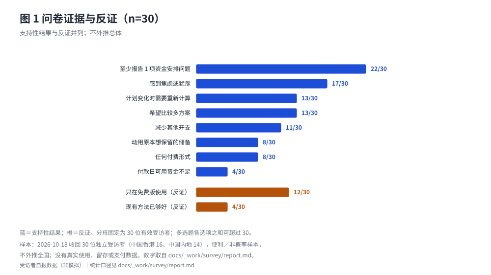

# 用户问题与需求证据

## 2.1 核心用户与主要任务

目标用户是 18—30 岁、有稳定生活费或实习收入的青年群体，以在校学生为主。本项目关注的大额支出有三个特征：**金额不小**（占生活费的比例本轮未调查）、**分多笔付**（定金、尾款、交通、住宿分散在不同日期）、**有硬时点**（如模拟案例 B 中门票 10/25 付款、往返车票 11/13—11/14 付款）。

他们的主要任务不是记账，而是回答三个问题：这场演出我到底能不能去、最早哪一天会差钱、在几个能去的方案里哪个整体更划算。这三个问题在现有工具里多半要靠用户自己心算或临时改表格；受访者最常提到的不足正是"计划变化时需要重新计算"（13/30）。

## 2.2 当前解决方式及其局限

在拿到产品之前，用户实际只有五类替代做法：记账类 App（记录已发生支出、月末看报表）、电子表格自建、支付平台账单、银行 App、凭感觉或日历提醒。它们的**共同缺口是"把余额当成结论"**：余额不区分必须保留的生活费，也不包含未来付款与到账时点，所以"看起来够、实际不够"。

逐类的能力边界（哪一类支持什么、哪一类"未核实"）集中在 6.3 节的竞品矩阵，本节不重复列举——那里的每格都标了证据状态，避免把"我没查到"写成"对方做不到"。

## 2.3 30 位受访者的关键发现

本项目的客户实证结论只有一个来源：本项目问卷。2026-10-18 收到 **30 位独立受访者（n=30）** 的作答，10 题全部作答；数据来自团队提供的 XLSX 导出件。脱敏分析数据、逐题统计与证据强度判断分别见 `docs/_work/survey/analysis/responses.csv`、`docs/_work/survey/report.md`、`docs/_work/survey/findings.md`[^S1]。

这三个限制必须先说清：

- **样本量口径为 30 位独立受访者**（团队确认，不做身份去重）；导出件没有应答编号，因此去重不是统计步骤，但也不能据此推断总体代表性。
- **不是全国样本**：样本为中国香港 16 位、中国内地 14 位；18—20 岁 22/30，21—26 岁 3/30，另有 18 岁以下 4/30、30 岁以上 1/30 不在 18—30 岁的目标年龄内，统计时未剔除；发放渠道与抽样设计未记录，按样本构成判断为**便利／非概率样本**。
- **只有自报数据**：没有真实使用、真实支付、留存、获客成本或价格点。

分母均为 30 位有效受访者；多选题各选项之和可超过 30。

图 1 把支持性结果与反证放在同一根标尺上：条形长度是 n/30，橙色两项是反证。它替代了原先的九行文字表——两者数字相同，但读图能立刻看出"焦虑 17/30"高于"付款日可用资金不足 4/30"，而后者恰是本项目最初的最强假设。

图 1 只放支持/反证两类；其余各题按维度汇总如下（同一图与表之间不重复计数）：

| 维度 | 样本内结果 | 能说明什么 |
| --- | --- | --- |
| 现有方式不足 | 计划变化需重算 13/30；手工输入麻烦 9/30；难比较完整方案 8/30；现有方法已够好 4/30 | 比较与重算是最突出的缺口 |
| 功能偏好 | 多方案比较 13/30；付款时间轴 11/30；必要资金保护 9/30；资金缺口预警 9/30；无吸引 4/30 | 方向与样本偏好一致，但不压倒 |
| 试用意愿 | 一定会／很可能会尝试 21/30；不确定 7/30；不太可能／一定不会 2/30 | 免费试用意愿偏正向，不等于实际使用 |
| 隐私顾虑 | 隐私与安全 16/30；遗漏费用／过于乐观 9/30；输入麻烦 9/30 | 隐私是采用的前置条件 |

另两项需要单独点出，因为它们直接改变定位：**跨城观演只有 9/30**，且该子组的资金问题比例与试用意愿不高于其他样本，因此切入场景是少数；**影响侧以焦虑为主**（17/30 感到焦虑或犹豫、11/30 减少其他开支、8/30 动用原本想保留的储备）；**付费只有方式偏好**（任何付费形式 8/30：按次 5、月费 2、一次性 1；只用免费版 12/30；希望机构免费提供 5/30；未定 4/30；视功能与效果而定 1/30；七类互斥、合计 30/30）。

## 2.4 18—30 岁目标年龄子样本（n=25）

本项目声明的目标年龄是 18—30 岁，而总体样本里有 5 人不在该区间（18 岁以下 4 人、30 岁以上 1 人）。为避免把区间外受访者混进目标人群的结论，本节用同一份脱敏数据（`docs/_work/survey/analysis/responses.csv`）把年龄为 18—20、21—23、24—26 的 25 位受访者单独切出来重算。这是一次性复算，不改动 `report.md` 的总体统计口径。

| 指标 | 全样本（n=30） | 18—30 岁子样本（n=25） |
| --- | --- | --- |
| 至少报告 1 项资金安排问题 | 22/30 | 17/25 |
| 感到焦虑或犹豫 | 17/30 | 14/25 |
| 计划变化时需要重新计算 | 13/30 | 10/25 |
| 功能偏好选"多方案比较" | 13/30 | 12/25 |
| 付款日可用资金不足 | 4/30 | 3/25 |
| 隐私与安全顾虑 | 16/30 | 15/25 |
| 免费试用前两档 | 21/30 | 19/25 |
| 任何个人付费形式 | 8/30 | 5/25 |

三点读法。**一，方向不变**：资金问题普遍、焦虑过半、"比较与重算"是首要缺口，在目标年龄段内同样成立。**二，付费信号更弱**：切到目标年龄后，"任何个人付费形式"由 8/30 降到 5/25（20.0%），付费意愿并未因"更接近目标用户"而上升——这是对个人付费路径的反向证据，第七章因此只把它列为**可测试**而非优先路径。**三，子样本仍不代表总体**：25 人中有 22 人处于 18—20 岁，21 岁以上仅 3 人；它只是同一便利样本的年龄再切，不能外推，也不宜与总体做统计检验。

另有一项交叉事实值得记录：目标年龄子样本中，有跨城观演经历者 8 人、"任何付费形式"为 0 人；无此经历者 17 人、付费 5 人。方向与全样本的子组对比一致（`findings.md` C9），同样因 n 过小而只记录、不作结论。

## 2.5 样本内的反证

只报支持性数字会让评审无法判断证据强度。这批样本里有三条明确的**反向信号**，本稿照原样保留：

1. **"现有方法已够好"4/30**。说明至少在这批样本里，有约七分之一的人不认为现有做法构成问题，产品的替代必要性不是无条件的。
2. **"付款日可用资金不足"仅 4/30**。本项目最初最强的假设（付款日错配）在样本中是少数情形；更常见的是"忘记或低估后续费用"（8/30）与"计划变化需重算"（13/30）。这一结果直接改变了产品的主结论顺序：把"完整方案比较与重算"放在与"付款日缺口"同等重要的位置。
3. **任何付费形式仅 8/30**，且"只用免费版"12/30、"希望机构免费提供"5/30。个人付费意愿在这批样本里偏弱，因此本稿不把按次付费写成主路径（见第七章）。

三条反证都不改变"这类问题存在"的样本内结论，但都限制了它的强度和适用面。

## 2.6 三条核心问题假设的状态

| 假设 | 内容 | 本轮样本内证据 | 状态 |
| --- | --- | --- | --- |
| 付款日错配 | 用户用当前余额判断可行性，忽略未来付款与收入时点，临付款才发现缺口 | "付款日可用资金不足" 4/30；"忘记或低估后续费用" 8/30；"临时修改或取消计划" 6/30 | **部分支持**：更广义的后续费用低估比"付款日错配"更常见 |
| 重复资金占用 | 同一笔钱既被当生活费又要付款，导致"看起来够、实际不够" | "动用原本希望保留的储备" 8/30；"无法清楚区分可消费资金与必要储备" 3/30 | **部分支持**：储备被侵蚀比"重复计算"更常见，假设需改写 |
| 组合不可行 | 逐项挑最低价拼起来，可能违反相容性约束或超出预算 | "难以比较多个完整消费方案" 8/30；"计划变化时需要重新计算" 13/30；"难以比较不同方案的总成本" 6/30 | **部分支持**：比较与重算的痛点成立，"整体不可行"这一后果未被直接测量 |

本稿不以模拟案例、测试通过或虚拟回测作为需求成立的证据；上表只是样本内计数，不是总体比例。

## 2.7 仍待验证的需求与证据纪律

问卷只能回答"这类问题有没有被报告"，不能回答"用户是否愿意为解决方案改变行为"。四件事仍是空白，构成本轮之后的主要验证任务：**任务完成率**（能否无指导走完一次规划、卡在哪一步）、**结果理解与信任**（是否看得懂"付款缺口""暂无法完整判断""建议分配额"并据此改变安排）、**支付意愿与价格点**（问卷只测到方式偏好，没测任何价格）、**场景扩展优先级**（旅行与电子产品在样本中多于跨城观演，但没有对应案例与规则验证）。

记法上守四条：三条假设只用"部分支持／受挑战／待验证"表述，不写"用户需要""愿意付费""痛点普遍"；不把样本内比例填进市场漏斗，不把付费方式偏好当价格、付费率或收入，不把"愿意尝试"当实际使用；外部消费者调查、社交平台评论与模型生成数据**不进入**本项目的问卷结论；题面、字段、清洗与统计口径见 `docs/_work/survey/`，原始 XLSX 不入库。

[^S1]: 问卷题面与差异见 `docs/_work/survey/questionnaire.md`；字段与清洗规则见 `docs/_work/survey/schema.json`；逐题统计见 `docs/_work/survey/report.md`；证据强度、局限与反证见 `docs/_work/survey/findings.md`。复算脚本 `pnpm survey:report` 读脱敏分析数据。
