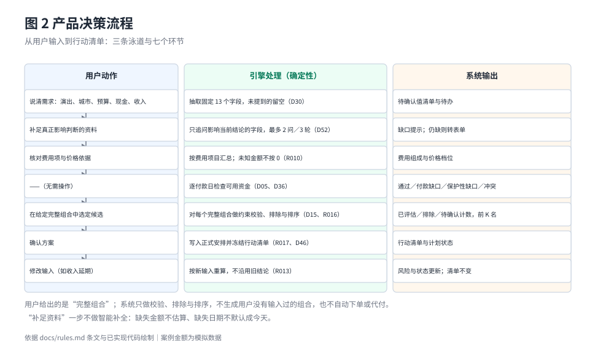
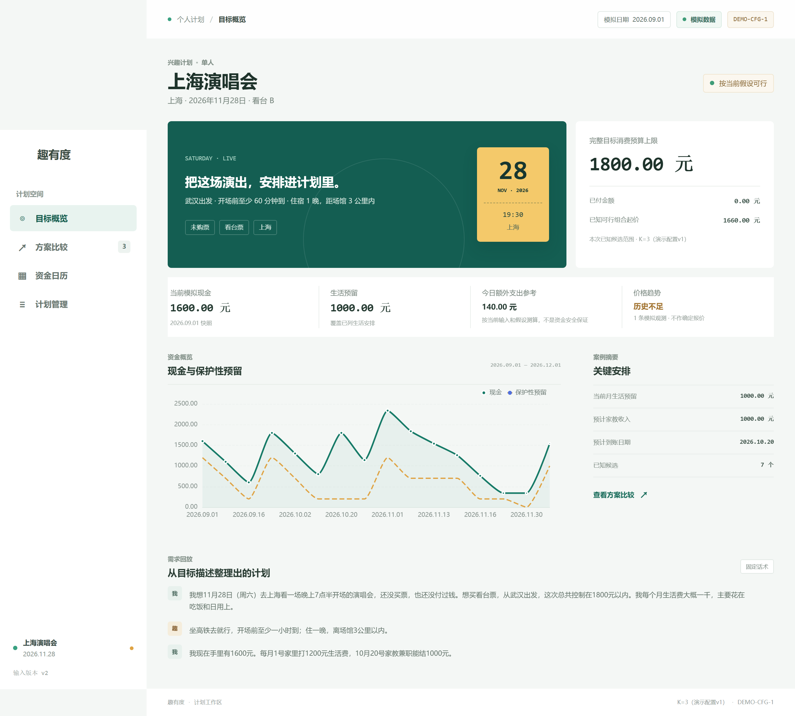
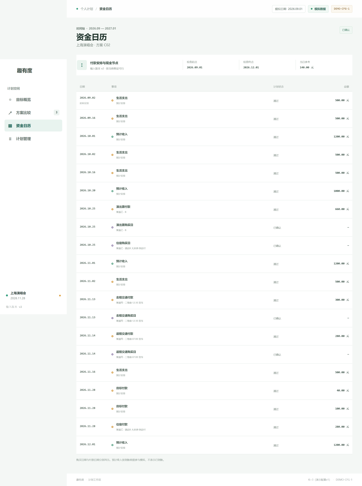
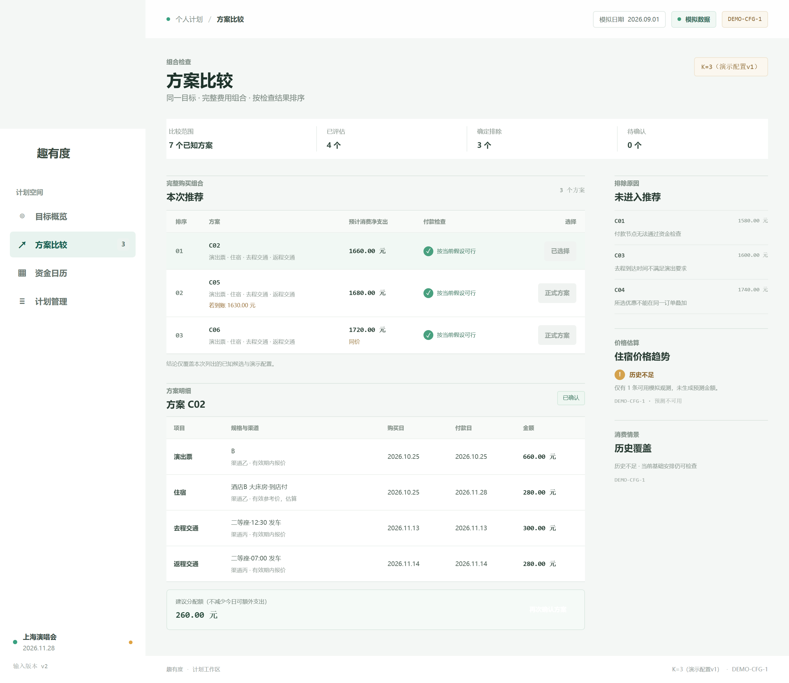
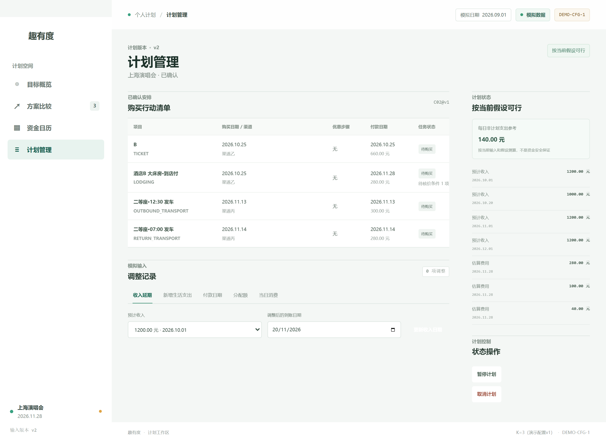
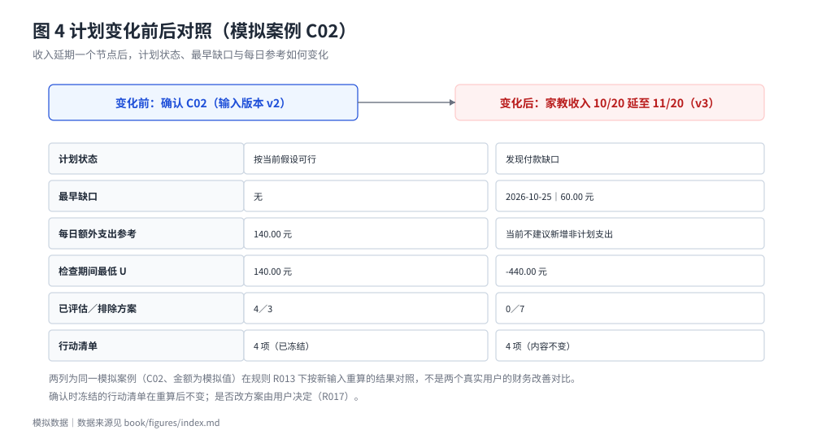

# 产品方案与真实使用流程

## 3.1 一次完整任务的七个环节

趣有度的使用过程不是"填一张表然后看结果"，而是一条有取舍的链路：先用自然语言说清需求，系统只补足真正影响判断的资料，再把费用、付款日、到账日排进资金时间轴，最后在用户给出的完整组合里比较、确认。

图 2 按泳道拆开七个环节：每一行是用户做的一步、引擎做的处理与系统给出的输出。它同时说明了两个容易被误读的地方——**第 2 环不做"智能补全"**（缺失的金额不会被估算填上，缺失的日期不会被默认成今天，D30、D52），**第 5 环不生成组合**（用户须自己给出完整候选，程序只做校验、排除与排序，D15、R016）。

这条链路的代价是用户会多填几次，收益是结论不建立在假设之上。各环节的规则编号与状态码见附录 A；四条待验证问题与产品机制、技术证据的对应关系集中在 4.7 节的创新点表与 2.6 节的假设状态表，本节不重复。

{width=52%}

截图 1 是确认方案 C02 之后（输入版本 v2）的目标概览页，数值与 `book/data/flows/02_cB_topk_reconfirm.json` 第 1 次确认的结果一致。页面顶部同时标出**模拟日期**、**模拟数据**标识与案例编号，避免把演示案例误读为真实记录。

中部把"完整目标消费预算上限"与"已付金额""已知可行组合起价"并列，再给出当前模拟现金、生活预留、今日额外支出参考（140.00 元）与价格趋势状态；下方是现金与保护性预留的曲线，以及把用户原话整理成"需求回放"的三段对话。这张图对应产品要回答的三个问题：付不付得起、组合贵不贵、今天还能花多少。

## 3.2 输入与资料补足

输入的最小集合是"要买什么、什么时候、多少钱、手上现在有多少、之后什么时候有多少"。系统把这五类拆成 13 个字段，并区分**已确认值**与**待确认值**：来自自然语言抽取的字段默认是待确认值，用户逐字段确认后才写入案例输入（`confirmations[]`），未经确认的推断不进入计算（D60）。

信息不足时系统不猜。金额未知记为"待填"，日期未知记为"待确认"，报价过期记为"过期"；只要这些缺口影响当前结论，计划状态就是"暂无法完整判断"（R010、§11.1）。

案例 B 的两个变体可以对照：住宿价格未知时（`cB_v3_lodging_unknown`），住宿记为"待填"，5 个方案中 3 个计入待确认、2 个因其他约束排除，计划状态为"暂无法完整判断"；住宿确认免费时（`cB_v4_lodging_free`），住宿按 0 元计入，2 个方案可行（1380.00 元、1440.00 元）。未知不按免费处理，免费也不当作未知。

## 3.3 费用计算与价格依据

费用按费用项目逐项汇总：净支出 = P（已付）+ F（后续应付）− R（可计入的返还）。优惠按订单落到具体付款上（D45、D65）；返现只有"付款即返、金额与日期明确、不依赖后续行为"才计入 R（D12、D42）。金额全程整数分，不使用浮点（R007）。

同一购买日按五档顺序取价（有效模拟报价 ＞ 已确认的合格预测 ＞ 有效参考价 ＞ 有效期未知的报价 ＞ 待填，D13、D43），**没有任何依据时不补造价格**；五档的完整定义与不确定性显示方式见 4.4 节。截图 1 中的"价格趋势：历史不足"即第二档不可用：住宿只有 1 条模拟观测（图 22），界面不显示预测金额，方案 C02 的住宿价取参考价并标"估算"。

图 3 是主线流程中方案 C02 的费用组成：必要费用按项目汇总，门票是其中最大一笔，其余为交通、住宿与餐饮等后续应付。柱顶金额单位为元，全部来自 `book/data/flows/01_cB_topk_main.json` 的导出结果，不是手写的示意数；该流程最后一步只延期收入、不改费用，所以 1660.00 元与确认时相同（见 3.6 节）。

## 3.4 付款时间轴与资金缺口

时间轴把每笔付款、每笔收入、预留建立与机动预留释放按日期排序，逐节点计算可用资金并判定状态。检查期间的起点是快照时刻，终点取"最后一笔目标相关收付款日"与"其后第一笔已确认收入到账日"的较晚者，仍受 2027-01-01 限制（D04、D41、D56）。同日先后只认案例显式给出的顺序；未知顺序时，流出排在不能确定已到账的流入之前，多笔流出先后未知时只报告日级累计缺口而不指认哪笔先失败（D10、D38）——这条规则避免了"猜顺序"带来的乐观结论。

{width=44%}

截图 2 是确认 C02 之后（v2）的资金日历：检查区间 2026.09.01—2026.12.01、当日参考 140.00 元，逐条列出生活支出、预计收入、演出票与往返交通付款，每条带"通过"或缺口状态；页面底部写明"预计收入按到账前提参与模拟，不表示已到账"。

## 3.5 完整候选方案的比较

候选比较的口径必须说清：**完整候选组合由案例输入给出，程序只做校验、排除与排序，不做排列组合生成**（D15）。也就是说，系统不会替用户"发明"新的消费组合；它做的是：对给定范围内的每一个完整组合，判断能不能通过约束与资金检查，并把能通过的按净支出排序。

三类计数互斥且合计等于比较范围：通过检查计入已评估数，确定排除计入确定排除数，其余计入待确认数。可行候选按预计消费净支出升序排列；同价并列标注，按候选编号升序截取，末位同价不突破 K；进入前 K 名的从 1 起编号、不重复（R016 第 7 条、§12.7）。

{width=56%}

截图 3 是同一时点（v2）的方案比较：7 个已知方案中已评估 4 个、确定排除 3 个、待确认 0 个，K=3，推荐 C02／C05／C06 并标注"若到账""同价"；排除区逐条给出原因（"付款节点无法通过资金检查""去程到达时间不满足演出要求""所选优惠不能在同一订单叠加"）——**最便宜的 C01 1580.00 元与 C03 1600.00 元都被排除，价格最低不等于可行**。

## 3.6 确认、行动清单与计划状态

确认是产品里唯一会写入正式安排的动作。确认前，候选方案、金额依据、依赖条件与付款安排都只是预览；确认后写入正式安排并把行动清单冻结（项目编号、渠道、购买日、付款日、适用优惠），之后风险与可行性按当前输入重算，清单不自动改变（R017）。确认时还会给出**建议分配额**（D18、D46，机制见 4.5 节）。

{width=44%}

截图 4 是确认后（v2）的计划管理页：购买行动清单分购票、住宿、去程、返程四类并给出购买日期与渠道；调整记录分五类且显示"0 项调整"；计划状态为"按当前假设可行"，每日非计划支出参考 140.00 元，并注明这只是按当前输入与假设的测算、不构成资金安全承诺。

四张截图合起来是一次完整任务：概览看结论、日历看时点、比较看取舍、管理看确认后的安排。**这四张图都是原型界面与模拟数据，不是用户实测成效，也不是真实市场成交记录。**

**确认之后的重算。** 主线流程（`fixtures/flows/01_cB_topk_main.json`）在确认之后还有一步：把 10/20 到账的 1000.00 元家教收入延期到 11/20。收入延期属于 D29 的编辑白名单，输入版本由 v2 变为 v3，系统按新输入重算，不沿用旧结论（R013）。图 3、图 6 与图 20 中的"主线流程"数据，都取自这一步之后的检查点。

图 4 把同一份模拟案例在收入延期前后的六个量并排：计划状态由"按当前假设可行"变为"发现付款缺口"；最早缺口出现在 10/25 购票日，是 60.00 元保护性资金缺口；检查期间最低 U 由 140.00 元降到 −440.00 元（11/14 返程车票付款后，11/20 收入到账后回正）；今日额外支出参考由 140.00 元变为"当前不建议新增非计划支出"；7 个方案全部被排除；确认时冻结的 4 项行动清单不变，是否改方案由用户决定（R017）。

这张图回答的是评审最常追问的一点：**一个"可行"结论在输入变化后会不会悄悄失效却仍显示可行**。答案是不会——状态、缺口、每日参考与方案计数同时翻转，而已确认的行动清单作为既成事实被冻结保留。

界面中的同一操作由端到端用例 T018-09 覆盖：延期后计划管理页显示最早缺口的日期与金额，不显示失败概率；本稿没有这一步的截图，图 4 的数值直接取自引擎导出结果。

## 3.7 边界：本版明确不做

- 不做贷款、分期推荐，不通过新增授信或压缩必要生活费来"补"缺口。
- 不做真实资金操作、账户连接、自动下单、全网爬取、跨币种自动换算。
- 不为凑方案扩大购买清单，不把逐项最低价拼接当作完整组合可行，不把"取消"包装成最低成本方案。
- 不做超出简单方法范围的复杂市场预测，不对未来价格、库存或优惠资格作承诺。
- 不自动生成用户没有输入过的消费组合；候选范围始终由输入决定。

这些边界不是能力不足的托词，而是产品定位的一部分：一旦允许"替你借钱"或"替你下单"，产品就从决策辅助变成交易环节，需要完全不同的合规与责任安排。
