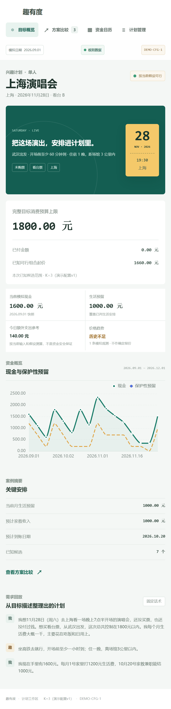
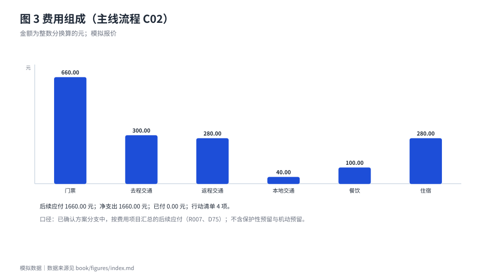
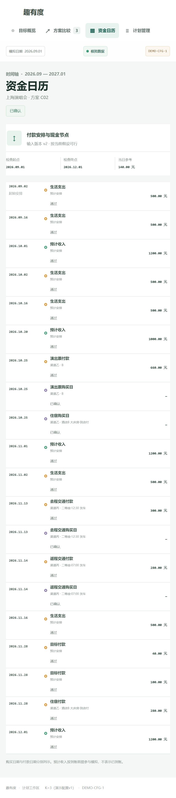
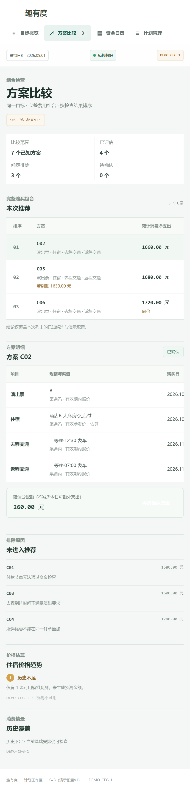
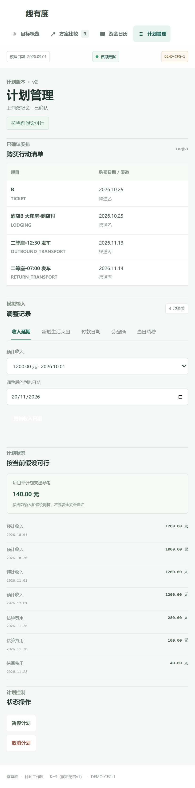

# 产品方案与真实使用流程

## 3.1 一次完整任务的七步链路

趣有度的使用过程不是"填一张表然后看结果"，而是一条有取舍的链路：先用自然语言说清需求，系统只补足真正影响判断的资料，再把费用、付款日、到账日排进资金时间轴，最后在用户给出的完整组合里比较、确认。

1. **说需求**：用户描述演出、出发城市、预算、现有现金、预计收入与生活费安排。系统只提取规则固定的 13 个字段，未提到的字段留空并进入待办，不猜测（D30）。演示用固定话术离线回放，不调用模型（7.4 节）。
2. **补足关键资料**：只追问影响当前判断的字段，每轮最多 2 个问题、最多 3 轮；仍缺失则改为表单补填（D52）。
3. **算费用**：必要费用按费用项目列出，区分已付、待付、确认免费与待填；未知金额不按 0 处理（R010）。
4. **排付款**：把每笔付款与收入排进资金时间轴，逐节点判定通过、付款缺口、保护性资金缺口或分配冲突（D05、D36）。
5. **比方案**：在案例给出的完整候选组合中做约束校验、排除与排序，最多显示前 K 名（D15、R016）。
6. **确认**：用户选定并确认后，才写入正式账面安排，并冻结行动清单（R017、D46）。
7. **重算**：用户修改输入后重新计算；风险与状态自动更新，已确认的渠道、日期、优惠与方案不自动改变（R013、R017）。

这条链路的关键取舍是**第 2 步不做"智能补全"**：缺失的金额不会被估算填上，缺失的日期不会被默认成今天。用户因此会多填几次，但结论不会建立在假设之上。

{width=34%}

截图 1 是确认方案 C02 之后（输入版本 v2）的目标概览页，数值与 `book/data/flows/02_cB_topk_reconfirm.json` 第 1 次确认的结果一致。页面顶部同时标出**模拟日期**、**模拟数据**标识与案例编号，避免把演示案例误读为真实记录。

中部把"完整目标消费预算上限"与"已付金额""已知可行组合起价"并列，再给出当前模拟现金、生活预留、今日额外支出参考（140.00 元）与价格趋势状态；下方是现金与保护性预留的曲线，以及把用户原话整理成"需求回放"的三段对话。这张图对应产品要回答的三个问题：付不付得起、组合贵不贵、今天还能花多少。

## 3.2 输入与资料补足

输入的最小集合是"要买什么、什么时候、多少钱、手上现在有多少、之后什么时候有多少"。系统把这五类拆成 13 个字段，并区分**已确认值**与**待确认值**：来自自然语言抽取的字段默认是待确认值，用户逐字段确认后才写入案例输入（`confirmations[]`），未经确认的推断不进入计算（D60）。

信息不足时系统不猜。金额未知记为"待填"，日期未知记为"待确认"，报价过期记为"过期"；只要这些缺口影响当前结论，计划状态就是"暂无法完整判断"（R010、§11.1）。

案例 B 的两个变体可以对照：住宿价格未知时（`cB_v3_lodging_unknown`），住宿记为"待填"，5 个方案中 3 个计入待确认、2 个因其他约束排除，计划状态为"暂无法完整判断"；住宿确认免费时（`cB_v4_lodging_free`），住宿按 0 元计入，2 个方案可行（1380.00 元、1440.00 元）。未知不按免费处理，免费也不当作未知。

## 3.3 费用计算与价格依据

费用按费用项目逐项汇总：净支出 = P（已付）+ F（后续应付）− R（可计入的返还）。优惠按订单落到具体付款上（D45、D65）；返现只有"付款即返、金额与日期明确、不依赖后续行为"才计入 R（D12、D42）。金额全程整数分，不使用浮点（R007）。

价格依据分五档，同一购买日按顺序取价：有效模拟报价 ＞ 已确认的合格预测 ＞ 有效参考价（标"估算"）＞ 有效期未知的报价（标"估算"）＞ 待填（D13、D43）。没有任何依据时**不补造价格**——界面显示"待填"，并把候选计入待确认数。

截图 1 中的"价格趋势：历史不足"是另一回事：住宿只有 1 条模拟观测（图 13），第二档"合格预测"不可用，界面不显示预测金额；方案 C02 的住宿价因此取参考价并标"估算"，行动清单提示复核价格。

图 4 是主线流程中方案 C02 的费用组成：必要费用按项目汇总，门票是其中最大一笔，其余为交通、住宿与餐饮等后续应付。柱顶金额单位为元，全部来自 `book/data/flows/01_cB_topk_main.json` 的导出结果，不是手写的示意数；该流程最后一步只延期收入、不改费用，所以 1660.00 元与确认时相同（见 3.6 节）。

## 3.4 付款时间轴与资金缺口

时间轴把每笔付款、每笔收入、预留建立与机动预留释放按日期排序，逐节点计算可用资金并判定状态。检查期间的起点是快照时刻，终点取"最后一笔目标相关收付款日"与"其后第一笔已确认收入到账日"的较晚者，仍受 2027-01-01 限制（D04、D41、D56）。

同日先后只认案例显式给出的顺序：未知顺序时，流出排在不能确定已到账的流入之前；多笔流出先后未知时，报告日级累计缺口而不指认具体哪笔先失败（D10、D38）。这条规则避免了"猜顺序"带来的乐观结论。

{width=34%}

截图 2 展示确认方案 C02 之后（v2）的付款安排与现金节点：检查起点 2026.09.01、检查终点 2026.12.01、当日参考 140.00 元，逐条列出生活支出、预计收入、演出票付款、往返交通付款与目标付款，每条都带"通过"或缺口状态。页面底部明确写着"购买日期与付款日期分别列示。预计收入按到账前提参与模拟，不表示已到账"——这句话是产品不对未来收入作乐观假设的直接说明。

## 3.5 完整候选方案的比较

候选比较的口径必须说清：**完整候选组合由案例输入给出，程序只做校验、排除与排序，不做排列组合生成**（D15）。也就是说，系统不会替用户"发明"新的消费组合；它做的是：对给定范围内的每一个完整组合，判断能不能通过约束与资金检查，并把能通过的按净支出排序。

三类计数互斥且合计等于比较范围：通过检查计入已评估数，确定排除计入确定排除数，其余计入待确认数。可行候选按预计消费净支出升序排列；同价并列标注，按候选编号升序截取，末位同价不突破 K；进入前 K 名的从 1 起编号、不重复（R016 第 7 条、§12.7）。

{width=34%}

截图 3 是同一时点（v2）的方案比较：比较范围 7 个已知方案，已评估 4 个、确定排除 3 个、待确认 0 个，K=3。推荐区列出 C02、C05、C06 三个方案及预计消费净支出，并标注"若到账""同价"等差异；C07 与 C06 同为 1720.00 元，按编号只显示 C06。

排除区逐条给出原因："付款节点无法通过资金检查""去程到达时间不满足演出要求""所选优惠不能在同一订单叠加"。最便宜的两个组合（C01 1580.00 元、C03 1600.00 元）分别因资金检查与到达时刻被排除，说明价格最低的组合不一定可行。

## 3.6 确认、行动清单与计划状态

确认是产品里唯一会写入正式安排的动作。确认前，候选方案、金额依据、依赖条件与付款安排都只是预览；确认后写入正式安排并把行动清单冻结（项目编号、渠道、购买日、付款日、适用优惠），之后风险与可行性按当前输入重算，清单不自动改变（R017）。

确认时还会给出**建议分配额**：在不为制造"可行"结论而压缩今日可额外支出的前提下，为本次目标最多还能增加多少分配。它的取值机制见 4.5 节，界面名称为"建议分配额（不减少今日可额外支出）"（D18、D46）。

{width=34%}

截图 4 是确认后（计划版本 v2）的计划管理页：上方"购买行动清单"区分购票、住宿、去程与返程四类项目，各自给出购买日期与渠道；中部"调整记录"把用户可做的事前调整分成收入延期、新增生活支出、付款日期、分配额、当日消费五类，并显示"0 项调整"。

下方"计划状态"写着"按当前假设可行"，每日非计划支出参考为 140.00 元，并注明这只是按当前输入和假设的测算、不构成资金安全承诺；页面底部提供暂停与取消两种计划控制。

四张截图合起来是一次完整任务：概览看结论、日历看时点、比较看取舍、管理看确认后的安排。**这四张图都是原型界面与模拟数据，不是用户实测成效，也不是真实市场成交记录。**

**确认之后的重算。** 主线流程（`fixtures/flows/01_cB_topk_main.json`）在确认之后还有一步：把 10/20 到账的 1000.00 元家教收入延期到 11/20。收入延期属于 D29 的编辑白名单，输入版本由 v2 变为 v3，系统按新输入重算，不沿用旧结论（R013）。图 4、图 6 与图 14 中的"主线流程"数据，都取自这一步之后的检查点。

重算结果：计划状态由"按当前假设可行"变为"发现付款缺口"；最早缺口在 10/25 购票日，是 60.00 元保护性资金缺口，11/14 返程车票付款后 U 最低到 −440.00 元，11/20 收入到账后回正；今日额外支出参考由 140.00 元变为"当前不建议新增非计划支出"，7 个方案全部被排除。确认时冻结的 4 项行动清单不变，是否改方案由用户决定（R017）。

界面中的同一操作由端到端用例 T018-09 覆盖：延期后计划管理页显示最早缺口的日期与金额，不显示失败概率；本稿没有这一步的截图。

## 3.7 问题到功能的对应关系

四条待验证问题各自对应一个产品机制。技术证据只说明实现与断言一致，不说明用户需要这个功能；客户证据只来自第二章的问卷。

| 待验证问题 | 产品机制 | 现有技术证据 | 客户证据状态 |
| --- | --- | --- | --- |
| 付款日期与收入到账错配 | 资金时间轴与逐节点判断（R004、D04、D41） | 向量 T003—T006、T019；对拍差异 0 | 部分支持：付款日可用资金不足 4/30；忘记／低估后续费用 8/30 |
| 同一笔钱被重复占用 | 资金分区与保护性预留（R003、§1） | 向量 T004、T010；`tests/unit/daily.test.ts` | 部分支持：动用储备 8/30；无法区分可消费与必要资金 3/30 |
| 逐项最低价拼接后整体不可行 | 完整候选组合比较（D15、R016） | 向量 T011、T016；独立穷举复算 | 部分支持：难比较完整方案 8/30；计划变化需重算 13/30 |
| 不理解的估算与不确定性 | 价格依据、待确认与不可判断状态（§11、D76） | 向量 T009、T020；`resultCoreSchema` | 部分支持：隐私 16/30；遗漏费用／过于乐观 9/30 |

## 3.8 边界：本版明确不做

- 不做贷款、分期推荐，不通过新增授信或压缩必要生活费来"补"缺口。
- 不做真实资金操作、账户连接、自动下单、全网爬取、跨币种自动换算。
- 不为凑方案扩大购买清单，不把逐项最低价拼接当作完整组合可行，不把"取消"包装成最低成本方案。
- 不做超出简单方法范围的复杂市场预测，不对未来价格、库存或优惠资格作承诺。
- 不自动生成用户没有输入过的消费组合；候选范围始终由输入决定。

这些边界不是能力不足的托词，而是产品定位的一部分：一旦允许"替你借钱"或"替你下单"，产品就从决策辅助变成交易环节，需要完全不同的合规与责任安排。
