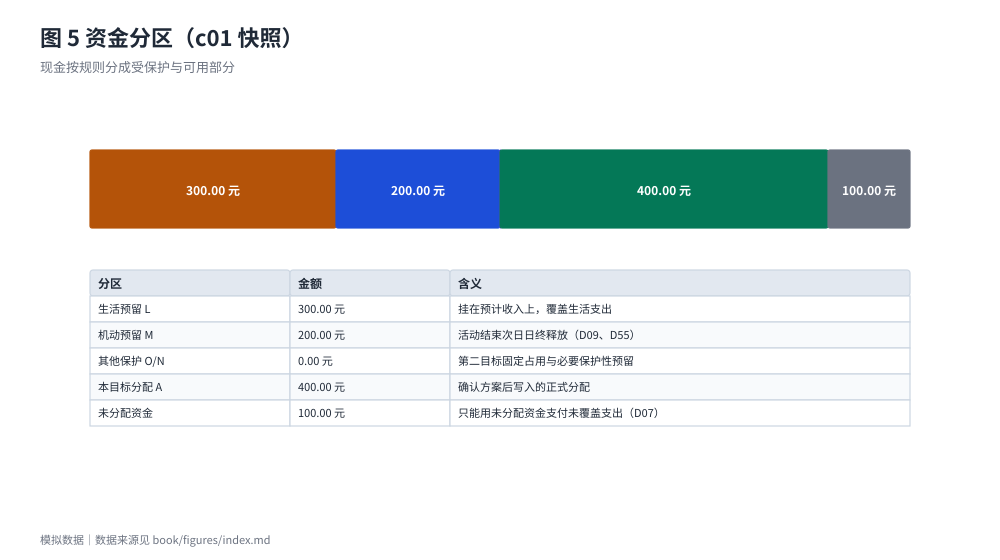
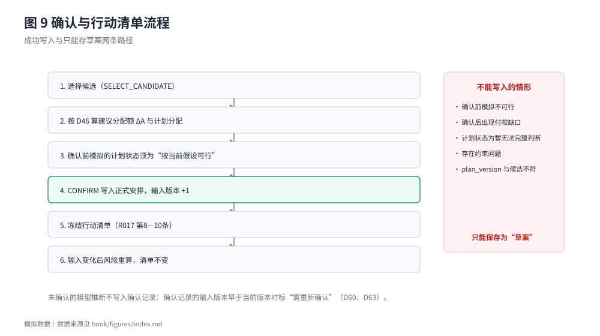

# 核心技术与创新机制

主文只解释五个最能说明差异化的机制：资金分区、付款时间轴、完整候选比较、价格依据、确认与分配额。完整的规则条文、状态码、边界条件与逐规则公式见附录 A。

## 4.1 资金分区：U 表示什么，不表示什么

在任一节点上，把现金 C 拆成五部分：生活预留 L、机动／应急预留 M、其他保护性预留 N、第二目标的固定占用 O、本目标分配 A；剩下的才是未分配资金。由此定义三个量：

- 本目标可用：**G = C − L − N − O**
- 付款空间：**H = G − M**
- 未分配资金：**U = H − A**

其中只有 U 可以支付没有预留覆盖的支出；不属于本目标的支出只能用 U，不得挪用 A 与保护性资金（D06、D07）。

**U 是本目标在该节点上的"未分配裕度"，不是"今天还能额外花多少"。** 这两个数在数值上通常不相等，混同会让后面所有结论都说不通。以案例 `c00_r019_minimal` 为例：快照节点的 U 为 <!-- data: cases/c00_r019_minimal.json#checkpoints.0.result.snapshot.unallocated.value | cents --> 元，而"每日非计划支出参考"为 <!-- data: cases/c00_r019_minimal.json#checkpoints.0.result.daily_reference.amount.value | cents --> 元。差额来自检查期间后续节点的支出——今天能动用的额度，受的是"整个检查期间最紧的那个节点"的限制，而不是今天的余额。

图 5 用的是另一份基础数据 `c01_base`：它比 c00 多 200.00 元机动预留，所以快照的未分配资金是 100.00 元，而不是上文的 300.00 元。

每日非计划支出参考 D 不是用余额除以天数，而是在完整检查期间上做探测：寻找最大的整数分 x，使"今天多花 x 元"之后资金时间轴仍然全部通过（R019、§4）。因此当 D 能够给出金额时，它实质等于检查期间各节点 U 的最小值（且不超过快照节点的 U）。这条性质是下一节"建议分配额"能够成立的基础。

## 4.2 付款时间轴与逐节点判断

每个节点依次判定（D05、D36）：

1. 若 **L + N + O + M > C**，为**保护性资金缺口**，界面金额为该节点的 −U，并分列"保护性预留超出现金"与"本目标分配无现金支撑"两项依据（D34）。
2. 否则若 **U < 0**，按引起 U 下降的原因分成两类：出现在快照、用户修改分配或预留、收入节点建立预留之后，为**分配冲突**；出现在某笔流出之后，为**付款缺口**。金额一律为该节点的 −U。
3. 其余为**通过**。

最早缺口只取检查期间内第一个保护性资金缺口或付款缺口；U 已为负但未继续下降的节点标"缺口延续"（D11、D35）。这条设计让"哪天开始不够"和"够不够"分开回答：前者是用户能行动的信息，后者只是一个布尔值。

图 6 取主线流程收入延期之后（v3）的 16 个节点：U 在 10/25 购票付款后转负，11/14—11/16 最低为 −440.00 元，11/20 收入到账后回正（见 3.6 节）。

图 7 取案例 A 新增一笔生活支出后的流程（`book/data/flows/04_cA_gap_living.json`）：最早缺口的界面金额按 D34 拆成两项依据，两项之和等于该节点的 −U。

落在同一节点上的多笔支出还存在"同日先后"问题。系统只承认案例显式给出的顺序；未知顺序时，流出排在不能确定已到账的流入之前；多笔流出先后未知时，报告日级累计缺口而不指认具体哪一笔先失败（D10、D38）。这条规则让结论在信息不足时保持保守——不会因为假设"钱先到账"而把一个实际不可行的方案判成可行。

## 4.3 完整候选组合的约束检查与排序

候选比较的边界必须说清，因为它决定了产品能力的真实上限：

- **系统不生成组合。** 完整候选组合由案例输入给出，程序只做约束校验、排除与排序，不做排列组合生成（D15）。
- **系统做三件事。** 每一个给定组合都按同一套约束与资金检查评估；违反任一已填写约束的组合被确定排除并给出原因；能通过的组合按预计消费净支出升序排列，最多显示前 K 名（R016、D15）。
- **"不知道"不算"排除"。** 约束已经填写、而候选缺少比较所需字段时，该候选计入**待确认**数而不是被排除——宁可说"还不知道"，也不误排除。

三类计数互斥且合计等于比较范围：已评估（通过检查）、确定排除、待确认。这条恒等式是结果可核对的抓手：只要三者之和不等于范围，结论就是错的。

## 4.4 价格依据与不确定性

同一购买日按五档顺序取价：有效模拟报价 ＞ 已确认的合格预测 ＞ 有效参考价（标"估算"）＞ 有效期未知的报价（标"估算"）＞ 待填（D13、D43）。未确认的预测不属于第二档，取下一档并提示存在待确认的预测；有效期未知的报价只作估算，不当作有效报价；没有任何依据时不补造价格。

不确定性不是靠"给个中位数"消化的，而是靠三种显示方式分流的：给出金额、"当前不建议新增非计划支出"（0 元不代表原计划可行）、"暂无法给出建议金额"（信息不足，不以 0 代替）。优惠同样受条件约束：折扣、满减、返现、返券的可叠加性由案例给出计算顺序，未给出则计入待确认；依赖未确定条件的优惠不得进入结论（R007、R011）。

## 4.5 确认机制：建议分配额 ΔA 与"不减少今日可额外支出"

这是全稿最容易被误读的一处，因此把它写成可核对的推导。

**问题**：确认时若把本目标分配 A 从 A0 增加到 A0 + ΔA，那么由 U = H − A 可知，凡是 A 仍然有效的节点，U 都会**等额下降 ΔA**。如果规则要求"确认后每个节点的 U 都不降低"，那就只有 ΔA = 0 能满足——这与产品要"多分配一点"的目标矛盾。所以那条约束不可能是"每个节点都不降"。

**实际规则（D46）**：设 W 为剩余计划目标付款中未被预留覆盖的部分，m 为确认前模拟中检查期间**全部节点 U 的最小值**（含快照节点）。ΔA 取 `[0, max(0, W − A0)]` 内满足下式的**最大整数分**：

> 确认后模拟中，全部节点 U 的最小值 ≥ m

条件随 ΔA 单调，可用二分求解；验收标准是"ΔA 满足条件，且 ΔA 小于上界时 ΔA + 1 不满足"。也就是说，规则保护的是**最小值不被压低**，而不是每个节点不动。

**为什么界面写"不减少今日可额外支出"**：由 4.1 节，每日参考 D 就是各节点 U 的最小值（U 非负时）。因此"最小 U 不低于 m"等价于"今日可额外支出不减少"。界面名称为"建议分配额（不减少今日可额外支出）"，指的是这个最小值，而不是每一个节点。

**可核对的例子（向量 T017-04，已冻结）**：A0 = 0，W = 850.00 元，确认前各节点最小 U = m = 200.00 元。按 D46 得 ΔA = 300.00 元、A = 300.00 元，计划分配 550.00 元挂在 9/20 的收入上。确认后：快照节点的 U 由 500.00 元**降到** 200.00 元（下降的正是 ΔA），而检查期间的最小 U 仍然是 200.00 元。若按"每个节点都不降"的读法，这个例子只能得出 ΔA = 0，与规则条文和实现都不符。

**两个推论**：
1. 若快照节点本身就是最小值（今天没有余量），ΔA 必然为 0——产品不会为了多分配而压缩今天可花的钱。
2. ΔA 只是"建议"，用户可以不改；确认前若计划状态不是"按当前假设可行"，只能存为草案，不写正式分配（D46、R017 第 4 条）。

## 4.6 可复算与可追溯

结果不是一组数字，而是一棵带依据的树：每个金额都是 `{value, basis}`，`basis` 记录该值依据的规则编号、参与计算的预留与事件；节点记录触发它的事件与相关项目；方案记录版本号与输入版本。这让"这个数是怎么算出来的"可以逐层追问，而不是靠日志。

四个可验证的性质：

- **确定性**：同一输入与配置重复执行，结果逐字节相同；不使用系统时钟、随机数与网络。
- **整数分**：金额一律整数分（`Number.isSafeInteger`），禁止浮点金额运算（R007）。
- **可追溯**：金额追溯到规则编号与事件；缺口追溯到节点下标；确认追溯到方案版本与输入版本。
- **可复算**：任何结论都能由仓库内的受控输入重建，不需要真实账户或真实价格（附录 C）。

## 4.7 创新点小结

| 创新点 | 解决的具体问题 | 与传统方法的区别 | 实现程度 | 可复现证据 | 局限 |
| --- | --- | --- | --- | --- | --- |
| 资金分区与保护性预留 | 生活费与目标预算混在一起，产生"看起来够" | 余额／预算工具通常只给一个可用数 | 已实现 | 向量 T004、T010 | 规则较多，首次使用需解释 |
| 付款时间轴与逐节点判断 | 总费用够，但某个付款日不够 | 日历提醒不判断"当天是否付得起" | 已实现 | 向量 T003—T006、T019 | 依赖用户提供付款日与收入信息 |
| 完整候选比较与价格依据五档 | 逐项最低价拼起来，整体可能不可行 | 比价工具不建模约束、付款日与优惠条件 | 已实现 | 向量 T009、T011、T016 | 候选由输入给出，不自动生成 |
| 确认冻结与"建议分配额" | 预览被当成正式安排；为制造可行结论而压缩当日开销 | 清单工具通常不区分预览／确认 | 已实现 | 向量 T017 全组；性质测试 | 会话内追加确认需重建输入版本 |
| "暂无法完整判断" | 信息不足时给出乐观结论 | 大多数工具用默认值补齐 | 已实现 | 向量 T009、T020；状态优先级测试 | 部分用户可能觉得"不给结论"不好用 |

需要强调的是：这五项都属于**机制层面的实现**，它们的正确性由规则与测试核对，但"用户是否因此做出更好的决定"没有任何对照实验支持。第五章会把这条边界写清楚。
