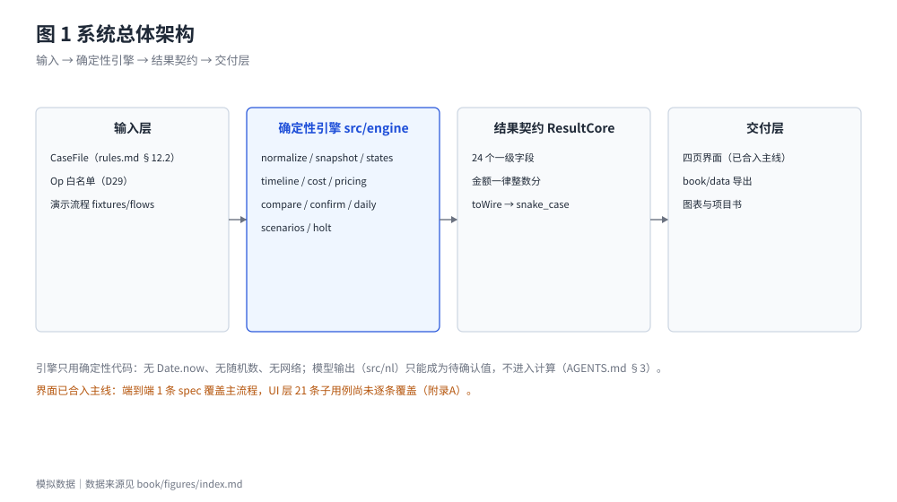
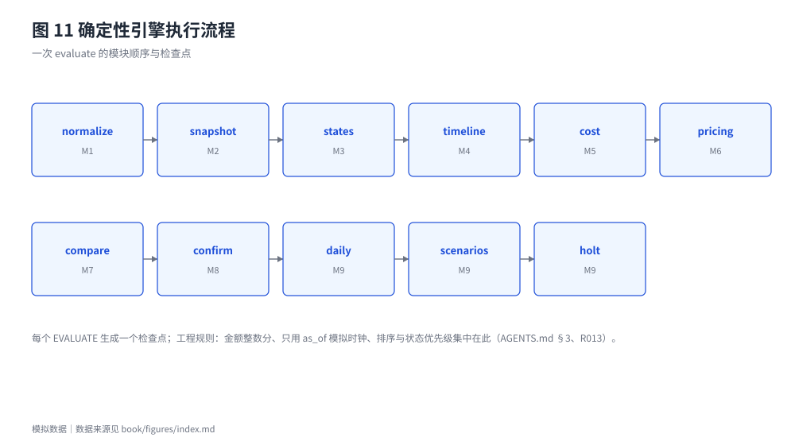
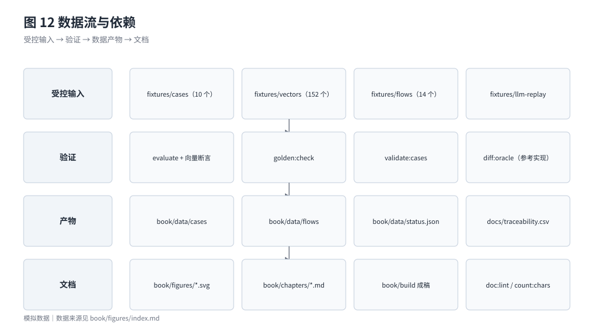

# 原型实现与技术验证

## 5.1 已实现的功能范围

引擎由 11 个计算模块组成，金额、日期、约束、排序与预测只在这里计算：

1. **输入层**：案例文件（结构与 `docs/rules.md` §12.2 一致）、操作白名单（D29）与演示流程。读入时按 §9 的字段表一一转换，未知字段一律拒绝。
2. **确定性引擎**（`src/engine`）：normalize、snapshot、states、timeline、cost、pricing、compare、confirm、daily、scenarios、holt，共 11 个模块；测试向量按 M1—M9 九组划分（`docs/_work/vector_modules.md`）。不使用系统时钟、随机数与网络。
3. **结果契约**：`ResultCore` 共 24 个一级字段；每个金额为 `{value, basis}`，`value` 为整数分。
4. **交付层**：导出结果、图表、正文与附录都从引擎输出生成，四页界面只消费 `ResultCore`。

已实现的模块为 <!-- data: index.json#meta.done_modules.0 -->—<!-- data: index.json#meta.done_modules.8 -->，配置版本 <!-- data: index.json#meta.config_version -->（比赛演示配置，不是已批准的最终默认）。模块完成度指"规则已实现且有对应测试"，不等于"已有真实用户验证"。

## 5.2 界面与引擎的分工

界面不参与任何金额计算：金额一律经 `formatCents` 显示，页面内的元→分转换只用于用户输入；页面的状态文案来自引擎结果中的标签代码，而不是前端自行判断。

这样分工的代价是界面表达受结果契约限制（有些解释性信息拿不到字段），收益是任何展示错误都能被判定为"契约或渲染问题"，而不会悄悄变成"算错"。当前已知的表达力缺口列在 5.6 节。

## 5.3 本轮实际运行结果

下表是本轮（2026-10-19）实际执行的命令与结果，不是历史记录。口径分开计数，不同口径不相互换算：

| 口径 | 结果 | 说明 |
| --- | --- | --- |
| 测试套件 | <!-- data: status.json#unit.suites --> | vitest 的 suite 计数，含文件内的 describe 分组 |
| 测试文件 | <!-- data: status.json#unit.files --> | vitest 实际运行的测试文件数 |
| 单元测试用例 | 通过 <!-- data: status.json#unit.passed -->／失败 <!-- data: status.json#unit.failed -->／跳过 <!-- data: status.json#unit.skipped -->／注册 <!-- data: status.json#unit.tests --> | 注册数含跳过用例 |
| 测试向量 | 通过 <!-- data: status.json#vectors.vectors_passed -->／<!-- data: status.json#vectors.vectors_total --> | 一个向量含多条断言 |
| 向量断言 | 通过 <!-- data: status.json#vectors.assertions_passed -->／失败 0／跳过 <!-- data: status.json#vectors.assertions_skipped --> | 运行错误 <!-- data: status.json#vectors.run_errors --> |
| 案例与向量结构校验 | **通过** | 退出码 <!-- data: status.json#cases.exit_code -->（`validate:cases`） |
| Golden 冻结 | **通过** | 退出码 <!-- data: status.json#golden.exit_code --> |
| 规格自洽 | **通过** | `spec:lint` 警告 <!-- data: status.json#spec_lint.warnings --> 条 |
| 参考实现对拍 | 差异 <!-- data: status.json#oracle_diff.differences --> | 检查点 TypeScript <!-- data: status.json#oracle_diff.checkpoints_ts -->／参考实现 <!-- data: status.json#oracle_diff.checkpoints_oracle --> |
| 文档检查 | **通过** | <!-- data: status.json#doc_lint.checks --> 项检查，失败 <!-- data: status.json#doc_lint.failed --> |
| 端到端（Playwright） | **通过** | 通过 17／失败 0／跳过 0（按 spec 计） |
| 自然语言层子用例 | 6／6 已执行且通过 | 由单元测试覆盖，不是端到端 |

**这张表不等于"业务规则全部验证通过"。** 它说明的是：已登记的子用例、向量与文档检查在当前代码上运行通过。逐规则的覆盖分布见 5.4 与附录 B——其中仍有"部分覆盖"与"未执行"的条目。

## 5.4 UI 覆盖的真实分布

端到端用例数与 UI 子用例数不是同一口径，不能互相折算。UI 层共 21 条子用例，当前分布是：

| 状态 | 条数 | 含义 |
| --- | --- | --- |
| 已覆盖 | 13 | 有以子用例编号开头的端到端用例，直接断言界面文案或行为 |
| 部分覆盖 | 3 | 只有补充界面断言，未与子用例编号一一对应（T010-04、T011-03、T018-02） |
| 未覆盖 | 5 | 没有端到端用例（T001-03、T009-06、T013-01、T020-02、T020-04） |

因此**界面不计为整体通过**：17 条 spec 通过，描述的是主流程与其中 13 条子用例，不是全部 21 条。未覆盖的 5 条中有 2 条（T020-02、T020-04）对应"每日参考金额"的展示分支，属于高风险区域——一旦渲染层把"暂无法给出建议金额"显示成 0 元，用户会得到错误结论。

追溯表共 <!-- data: status.json#traceability.rows --> 条数据行：通过 <!-- data: status.json#traceability.pass -->、部分覆盖 <!-- data: status.json#traceability.partial -->、已执行未通过 <!-- data: status.json#traceability.failed -->、待执行 <!-- data: status.json#traceability.pending -->。"部分覆盖"与"待执行"不折算为通过。

图 16 柱顶的数字是行数除以 100 后的显示（"1.31"即 131 行），计数以上一段为准。

按规则看，"测试通过"一栏为"是"的只有一部分规则；其余规则的子用例里仍有部分覆盖或待执行项。附录 B 按规则逐行列出，本文不做概括性描述。

## 5.5 四种状态必须分开

同一个功能可以处在四种状态之一，本稿对每一处表述都指明是哪一种：

| 状态 | 判定标准 | 本项目实例 |
| --- | --- | --- |
| **代码实现** | 引擎中有对应代码路径且被调用 | 引擎 11 个计算模块全部有实现 |
| **自动化测试通过** | 有向量或单元测试断言并实际运行通过 | 见 5.3；逐规则分布见附录 B |
| **端到端可运行** | 浏览器里能走完主流程并产生正确展示 | 17 条 spec 通过，主流程可跑通 |
| **真实用户验证** | 有真实用户完成任务的证据 | **没有**。问卷不是使用验证 |

这四者之间没有蕴含关系：代码实现不代表测试通过，测试通过不代表端到端可运行，端到端可运行更不代表用户认可。

## 5.6 技术局限与结果契约缺口

1. **界面与端到端仍非整体通过**：见 5.4。5 条未覆盖子用例需要先补界面展示位置，或改用引擎契约级断言。
2. **自然语言的确认方式**：抽取→追问→草稿→逐字段确认→重建输入版本→重算已实现并可离线回放；"在一次会话内追加确认并自动加版本"（方案 B）需要新增流程操作，属正式数据契约变更，已裁决不启用。
3. **结果契约的表达力**：部分断言（如无日均参考字段、无待确认差异字段、价格依据不逐项输出）无法写成向量，只能由单元测试覆盖或登记为缺口（`docs/_work/vector_gaps.md`），不通过修改预期值来"消除"缺口。
4. **预测方法简单**：Holt 阻尼趋势只在少量样本上评估，结论限定为"按当前假设"，不构成价格承诺；历史不足时不给预测。
5. **规则密度**：D01—D88 共 88 条细则，对评审与用户都不友好。主文只保留五个核心机制，其余移入附录 A，这一处理不影响代码，但影响可读性——这是本轮结构改版的直接原因之一。
6. **只在单场景验证**：案例与规则围绕跨城观演设计；旅行、电子产品等其他大额消费场景没有对应案例，不能声称已支持。

## 5.7 安全、隐私、模拟数据与原创性

- **模拟数据边界**：全部案例、报价、优惠、历史价格与消费记录都是模拟数据，由大语言模型按规则生成，经确定性校验和版本固定后使用（`docs/scope.md`）；界面顶部固定显示"模拟数据"标识与模拟日期，导出结果带同样标识。`validate:cases` 与 `doc:lint` 双向拦截"把模拟数据当真实证据"的表述。
- **隐私**：产品不连接账户、不读取真实流水、不要求授权交易数据；问卷原始 XLSX 不入库，只保留脱敏分析数据与汇总结果（`docs/_work/survey/`）。
- **不虚报的机制**：状态与文案成对出现（"可行"必须附"按当前假设"），失败分支不隐藏；"0 元"与"暂无法给出建议金额"是两种不同状态，不能互相替代。
- **原创性与第三方素材**：代码、规则、图表与正文由本项目团队完成，模拟案例数据的生成方式见本节第一条；使用的开源依赖为 `decimal.js`、`zod`、`react` 等（见 `package.json`），未复制他人项目书文案、数据或架构。往期作品只用于研究方法，未复制内容（见 6.7 节与 `docs/_work/case_benchmarks.md`）。本稿不声称拥有专利，也不声称获得任何机构认可。
- **资金与合规**：产品不持有、划转或代付资金，不做授信、分期或投资建议。是否需要牌照或其他监管安排，本稿没有做法律评估；与机构合作前，由合作方按适用规定评估数据合规与消费者保护要求（见 7.6 节、8.5 节）。

## 5.8 尚未完成的验证

- 没有做真实用户可用性测试、价格测试或银行访谈，对应 8.3 节的 S2—S5。
- 四张界面截图来自原型（模拟数据），数值与 `book/data/flows/02_cB_topk_reconfirm.json` 第 1 次确认（v2）一致；收入延期之后（v3）的界面由端到端用例 T018-09 断言，但没有截图，书中用导出数据和图 6、图 14 展示。
- 自然语言层只验证了离线回放（<!-- data: status.json#nl_layer.covered -->／<!-- data: status.json#nl_layer.total --> 条子用例），实时调用模型没有测试。
