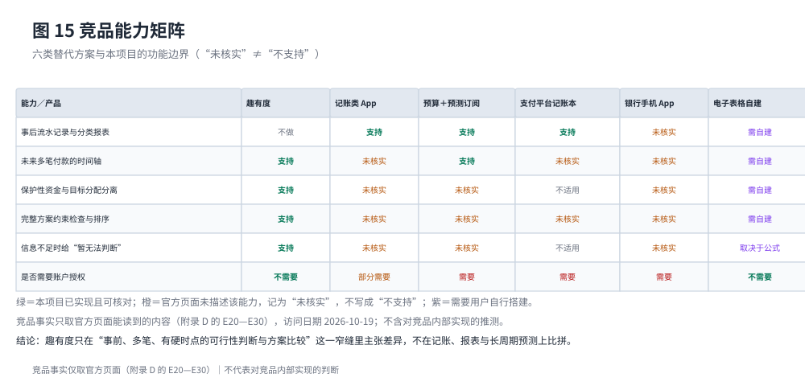
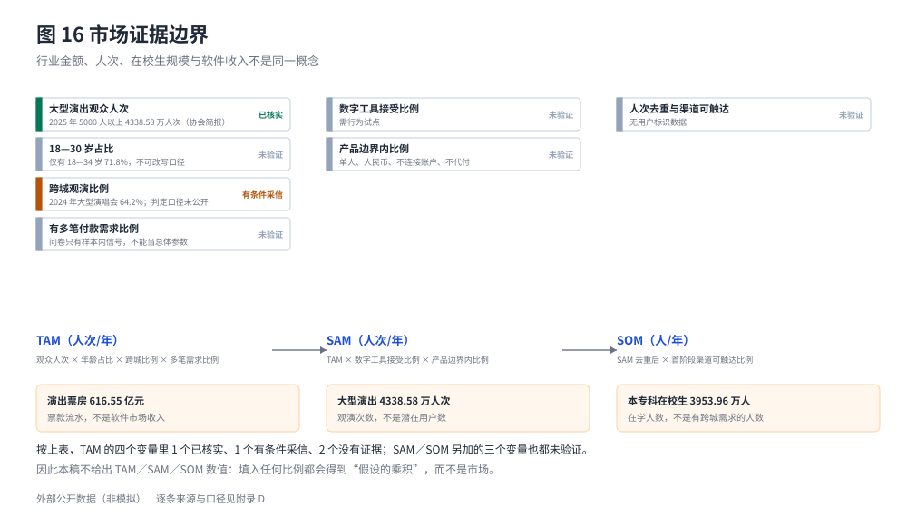

# 市场规模与竞争环境

本章的外部数据全部来自本轮实际打开的官方或协会发布页面（访问日期 2026-10-19，逐条链接与口径见附录 D）。凡协会原件不可访问、只能经权威媒体转述的，都在附录 D 标注"转述稿"。**外部消费金额不是软件市场收入**，6.5 节专门说明它们各自能支持什么。

**本章的外部数据都是内地口径。** 在校生数据明示不含港澳台[^E14]，演出协会数据只写"全国"、未说明是否含港澳台[^E19]；香港的演出市场、在校生与青年消费数据本轮未取得（附录 D.5）。因此本章不用于估计香港市场，香港侧的验证安排见 8.5 节。

## 6.1 相关消费行业背景：演出市场有多大

中国演出行业协会的年度简报给出 2025 年全国营业性演出（不含娱乐场所）的三组数：场次 64.04 万场（按可比口径 +6.58%）、**票房收入 616.55 亿元**（+6.39%）、**观演 1.94 亿人次**（+4.22%）[^E19]。到 2026 年 4 月的交易会上，协会进一步披露 2025 年演出市场**总体营业收入 837.22 亿元**（+5.19%），其中票房 616.55 亿元、**其他收入 220.67 亿元**[^E07]。

这三个数不能混用：

- **票房 ≠ 总营收**。谈"演出市场多大"必须说明是哪一个；票务环节能触达的资金口径上限是票房 616.55 亿元，不是 837.22 亿元。
- **人次 ≠ 人数**。1.94 亿是观演次数，同一人多次观演会重复计入，因此不能除以票房得到"人均票价"，也不能当作观众规模。
- **跨年度增速只能引用协会公布值**。协会在 2025 年简报中调整重述了 2024 年的场次与人次基数（用两年公布值直接相除会得到远高于公布值的增速），票房序列则连续可比。本稿只用公布增速，不自行计算。

与趣有度最相关的是大型演出这一细分：2025 年单场 5000 人以上的大型营业性演出 0.30 万场、票房 **324.48 亿元**、观众 **4338.58 万人次**（+18.81%），人次增速显著高于整体[^E19]。大型演出的观演人次占全部营业性演出的比例不到四分之一，却贡献了过半票房——这正是"金额不小、有硬时点"的场景集中地。

跨城观演是这个场景的关键特征，也是本轮研究最重要的收获：协会《2024 大型营业性演出市场趋势及特点分析》给出**2024 年大型演唱会跨城观演比例 64.2%**，其中跨省观演 44.2%[^E08]；协会与平台联合发布的 2025 年现场音乐演出报告称**大型音乐节跨城观演占比近七成**；协会负责人 2026 年 4 月受访时表述为"**全国范围大型演唱会、音乐节平均跨城观演率超 60%**"[^E08][^E09][^E10]。

这条证据支持一个有限但重要的结论：**跨城观演不是边缘情形，而是大型演出的主流形态**，因此"演出前要在两个城市之间安排多笔付款"是真实存在的任务，不是本项目的想象。它不支持其他结论：协会未公开"跨城观演"的判定口径与测算方法，也没有给出跨城观演者的人均支出分布。

## 6.2 目标用户与可触达场景

**在校大学生是规模最明确、也最容易触达的子群。** 教育部《2025 年全国教育事业发展统计公报》显示：普通、职业本专科在校生 **3953.96 万人**，各种形式的高等教育在学总规模 **4872.57 万人**，毛入学率 61.30%[^E14]。公报脚注明示不含港澳台。这个数字只是内地在校大学生规模的上界参照；香港在校生数据本轮未取得（附录 D.5），问卷中居住在香港的 16 位受访者不在这个口径内。

**但它不是 18—30 岁青年人口。** 国家统计局 2025 年末人口解读只给到 16—59 岁 85136 万人、15—64 岁 96848 万人等宽口径，**官方未发布 18—30 岁单一年龄段人口数**[^E13]。因此本稿不给"青年人口规模"的数字，也不从宽口径里减出目标年龄段——那是自行推算，不是官方数据。

**年龄结构只找到近似口径。** 协会与平台联合的 2025 年现场音乐演出报告给出"**18—34 岁占观演总人数 71.8%**、35 岁及以上 22.6%"[^E09]。这是本轮找到的唯一一份按年龄分组的公开数据，但它的分组是 18—34 岁、口径限于现场音乐演出与平台数据，**不能改写成本项目的"18—30 岁"**。

**付费痛点有官方旁证。** 中国消费者协会《2025 年上半年全国消协组织受理投诉情况分析》把演出票务列为热点之一：演唱会投诉量逐月攀升、**退款诉求占比超过 90%**，主要问题包括单方"不可退票"、提前一个月禁退、手续费过高、主办方临时取消不担责；消协建议主管部门牵头制定演出行业退票管理办法与阶梯手续费[^E15]。

退款诉求超过 90% 这一结果不能证明用户需要"事前资金规划"，但它说明演出票务的付款与退改条件是真实的消费者争议集中区——而这正是"付款时点、可退性与资金占用"的相邻问题。

## 6.3 个人财务管理软件与替代方案

竞品事实只采用官方页面能读到的内容；官方页面未描述的记"未核实"，不记作"不支持"。这与本章开头的方法一致：不靠贬低竞品来证明差异。

图 15 用同一套视觉编码把六类替代方案与趣有度放在一起：**绿色只标本项目已实现且可核对的能力；橙色一律写"未核实"，不写"不支持"；紫色表示需要用户自建**。这样处理会让趣有度显得"能做的事很窄"，但这是真实的能力边界——把未知画成"对方不支持"，评审一查就崩。

四类替代品的强弱很清楚：记账类在"事后复盘"上比本产品完整；预算＋预测类订阅产品在"长周期预测"上远为成熟；支付平台内置记账本在"有真实流水、零录入成本"上几乎无法竞争；银行 App 在"权威账户数据"上不可替代。趣有度只能在**"事前、多笔、有硬时点的可行性判断与方案比较"**这一窄缝里建立差异。

值得注意的是**替代威胁的方向**：第三方支付平台已把"自动同步账单＋收支统计＋月度报表＋到期提醒"做成内置功能，官方用户手册通篇未列收费项[^CP_BK]（只能写"未披露收费"，不能断言永久免费）。这意味着"记账"这一层在中国市场基本没有付费空间，任何收费都必须建立在记账之外的能力上。

## 6.4 收费模式参考：官方公开价格

下表只记录官方页面上的原文价格，不做汇率换算，也不判断哪个更合理。完整条目（币种、周期、适用地区、免费政策）见附录 D。

| 产品 | 归属 | 现行官方价格（原文币种与周期） | 免费／试用政策 |
| --- | --- | --- | --- |
| YNAB | YNAB | 年付 109 美元／年；月付 14.99 美元／月 | 34 天免卡试用；在校大学生 365 天免费；无免费版[^CP_OS] |
| Monarch | Monarch | Core 99.99 美元／年；Plus 199.99 美元／年 | 首周试用；官网说明按美元计价[^CP_OS] |
| PocketSmith | PocketSmith | 免费版；Foundation 9.99 美元／月（年付）起，最高 26.66 美元／月 | 免费版可用，但预测跨度限 6 个月；14 天内可退款[^CP_OS] |
| 随手记 | 金蝶系 | 连续包年 ¥273、连续包季 ¥72、连续包月 ¥28（官方商店页） | 免费＋内购＋会员；官网无价目表[^CP_CN] |
| 鲨鱼记账 | 鲨鱼快游 | 会员 15 元／月、38 元／季、148 元／年 | 免费＋会员；具体权益以 App 内公布为准[^CP_CN] |

两条路线在官方页面上都能看到：一条是"免费＋增值订阅"（中国记账类产品），一条是"纯订阅＋把预测能力放在高价档"。

后者尤其值得注意：Monarch 的定价页 FAQ 明确写"With Plus, you can plan further ahead with our forecasting tools"，PocketSmith 直接把预测跨度写进档位（免费版 6 个月、Foundation 10 年、Flourish 30 年、Fortune 60 年）[^CP_OS]。这说明"前瞻规划能力"在成熟市场是可以单独定价的——但这个价位对应的是一套成熟的长周期预测产品，而不是本项目当前的能力。

需要提醒的是价格的可比性：这些价格来自不同国家、不同计费周期、含税与不含税不同，中国区价格取自应用商店的官方商品页（安卓渠道未核实），不能直接横向比较，更不能据此推断中国用户的付费意愿。

## 6.5 市场规模：能给公式，暂不能给数值

把"演出观众人次"直接当成"潜在用户数"是最常见的口径错误。本稿改用一条乘法式，把每一步的变量显式写出来，并逐个标注证据状态：

图 16 只做一件事：把 TAM／SAM／SOM 的公式与七个变量摆在一起，并标出每个变量当前是"已核实"、"有条件采信"还是"未验证"。**图里没有漏斗，也没有任何比例数字**——因为 TAM 的四个变量里只有一个已核实，SAM、SOM 另加的三个变量全都未验证。给出任何点估计都必须先凭空填入这些比例，那样得到的不是市场，而是假设的乘积。

图 16 下半部分同时说明三类**不可互相换算**的口径：

- 演出票房（616.55 亿元）是**票款流水**，不是软件收入；
- 大型演出的 4338.58 万人次是**观演次数**，不是潜在用户数；
- 本专科在校生 3953.96 万人是**在学人数**，不是有跨城观演需求的人数。

趣有度可能争取的收入只有两种形态：个人付费用户数 × 价格 × 频次，或机构采购／合作收入。这两组变量目前都没有数据，因此本稿不给 TAM／SAM／SOM 数值。

## 6.6 竞争结论

三条可检验的判断：

1. **差异点必须落在"事前可行性"上。** 记账、报表、流水同步都已被免费产品覆盖，趣有度在这三项上没有竞争力；"付款当天够不够""完整组合能不能过"才是它能主张的位置。
2. **最大的替代威胁不是同类创业产品，而是免费的内置工具。** 支付平台内置记账本与银行 App 都在用户的既有路径上，零录入成本；本产品要求用户主动输入需求与资金情况，这是必须用价值换取的额外成本。
3. **机构侧不是"银行会买"，而是"银行已经自建或采购系统"。** 工商银行（内地）个人手机银行的官方功能清单包含账户、转账、存款贷款、信用卡、投资理财、生活缴费与若干增值服务，**没有"记账／预算／消费分析"字样**[^CP_BK]；工银亚洲手机银行的功能本轮未核验。

工商银行分支机构公开的集中采购结果显示，其会采购"智慧财务综合管理平台、智能报销、校园缴费系统"这类机构软件（某校园项目含税金额 167.19 万元）[^CP_BK]。两条合起来只能支持一个谨慎的结论：银行会为**机构内部的财务系统**付费，但**没有任何公开证据**表明银行会采购面向个人的预算或资金规划产品（本轮抽查集采栏目未发现）[^CP_BK]。

## 6.7 往期展示作品的组织方法借鉴

本轮逐页打开了工行杯官网"往期作品"栏目的四个展示作品（首发财智星、青葵宝、兴农"小金通"、AI 绿鉴），只研究方法，不复制内容；四页均无附件、无章节、无奖项标注，因此**展示 ≠ 获奖**，也不构成可比较的完整方案[^GHX]。逐条对照与差异分析见 1.5 节，方法与取舍记录见 `docs/_work/case_benchmarks.md`。

四个页面的**共性**本身是一条重要信息：

- **它们都只有一段摘要。** 正文 100—200 字，没有需求链、没有测试结果、没有成本、收入或用户量。也就是说，"用一页说清"是官方展示的实际颗粒度，但这也意味着评审在展示页上**无法核实**任何主张。
- **技术标签前置到标题。** "小模型判别+大模型生成""动态智能风控""ESG 智能鉴证"——标题给技术标签，正文只重复一次、不再展开。
- **数字只有两种用途**：规模痛点（"1.8 亿 K12 学生"）或结构计数（"一底座／三层／四模块／七大模块"）。四篇都没有可验证的效果指标。
- **商业与风险披露极不对称**：只有兴农"小金通"在摘要里给出商业模式措辞（"多层收费、数据增值、合作共赢"），两篇既无商业模式也无风险表述。

由此得到三条可直接执行的组织方法，本稿据此调整：

1. **先给一页结论，再展开论证。** 摘要与第一章前置，规则编号与技术明细移入第四章与附录 A。
2. **在摘要级就给出可核实的颗粒度。** 这是本稿与四个展示页面**刻意不同**的地方：趣有度在正文里给出判定对象（每个付款日）、判定口径（D05／D34／D36）、可复算证据（向量编号与导出结果），而不是只给模块名称与主张。
3. **商业部分写路径与前提，不写预测。** 保留路径对比与首个验证动作，不给收入、转化率与市场规模。

不适用的方法也明确：往期作品多为平台型或面向机构的方案，可以直接讨论"对接某行某系统"；趣有度是个人决策辅助工具，**没有任何机构合作**，因此不采用"对接银行系统"的叙事，也不虚构接口。

[^E19]: 中国演出行业协会《2025 年全国演出市场简报》，经济日报 2026-01-13（记者姜天骄）与中国新闻网同日同题报道互证；本轮 2026-10-19 由项目组重新打开核对，数值一致。该篇给出场次、票房、观演人次与 5000 人以上大型演出四项。见 `docs/sources.md` 的 E19。
[^E07]: 经济日报 2026-04-21《2025 年全国演出市场总体收入达 837.22 亿元》（2026 中国（呼和浩特）演出交易会发布）：总营收 837.22 亿元、票房 616.55 亿元、其他收入 220.67 亿元。见 `docs/sources.md` 的 E07。
[^E08]: 中国演出行业协会《竞逐升级、多元发展——2024 大型营业性演出市场趋势及特点分析》，经济日报 2025-04-17 报道：2024 年大型演唱会跨城观演比例 64.2%、其中跨省观演 44.2%。见 `docs/sources.md` 的 E08。
[^E09]: 中国演出行业协会与灯塔专业版《格局升维，生态延展——2025 现场音乐演出市场分析报告》，中国青年网 2026-04-23 报道：大型演唱会票房 295.58 亿元、18—34 岁占观演总人数 71.8%、大型音乐节跨城观演占比近七成。见 `docs/sources.md` 的 E09。
[^E10]: 中国演出行业协会副会长兼秘书长潘燕 2026-04-21 受访表述（经济日报同篇）：全国范围大型演唱会、音乐节平均跨城观演率超 60%。属负责人受访定性表述，非报告表格值。见 `docs/sources.md` 的 E10。
[^E13]: 国家统计局《王萍萍：2025 年全国人口总量为 140489 万人》，2026-01-19：16—59 岁 85136 万人；官方未发布 18—30 岁单一年龄段人口数。见 `docs/sources.md` 的 E13。
[^E14]: 教育部《2025 年全国教育事业发展统计公报》，2026-07-06：本专科在校生 3953.96 万人、在学总规模 4872.57 万人；脚注注明不含港澳台。见 `docs/sources.md` 的 E14。
[^E15]: 中国消费者协会《2025 年上半年全国消协组织受理投诉情况分析》，2025-08-06：演唱会投诉量逐月攀升、退款诉求占比超过 90%。见 `docs/sources.md` 的 E15。
[^CP_OS]: 海外订阅类产品的官方定价页与常见问题：YNAB（ynab.com/pricing）、Monarch（monarch.com/pricing）、PocketSmith（my.pocketsmith.com/plans）、Copilot Money（copilot.money/faq），访问 2026-10-19。逐条价格、币种与限制见 `docs/sources.md` 的 E20、E21、E23（E22 价格未核实）。
[^CP_CN]: 中国记账类产品的官方商店页与应用内会员说明：随手记（`docs/sources.md` 的 E24）、鲨鱼记账（E25），访问 2026-10-19。官网无价目表，价格取自应用商店中国区官方商品页。
[^CP_BK]: 机构侧公开页面：工商银行个人手机银行官方功能说明（`docs/sources.md` 的 E27）、南京分行集中采购结果公示（E28）、第三方支付平台记账本官方用户手册（E29）、工商银行集中采购信息公开栏目抽查（E30），访问 2026-10-19。E27 是否定性证据：官方功能清单无记账／预算字样。
[^GHX]: 工行杯官网"往期作品"栏目四个展示作品的摘要页：首发财智星、青葵宝、兴农"小金通"、AI 绿鉴，访问 2026-10-19。见 `docs/sources.md` 的 GH08—GH11；列表与摘要不等于获奖，也未取得完整项目书。
