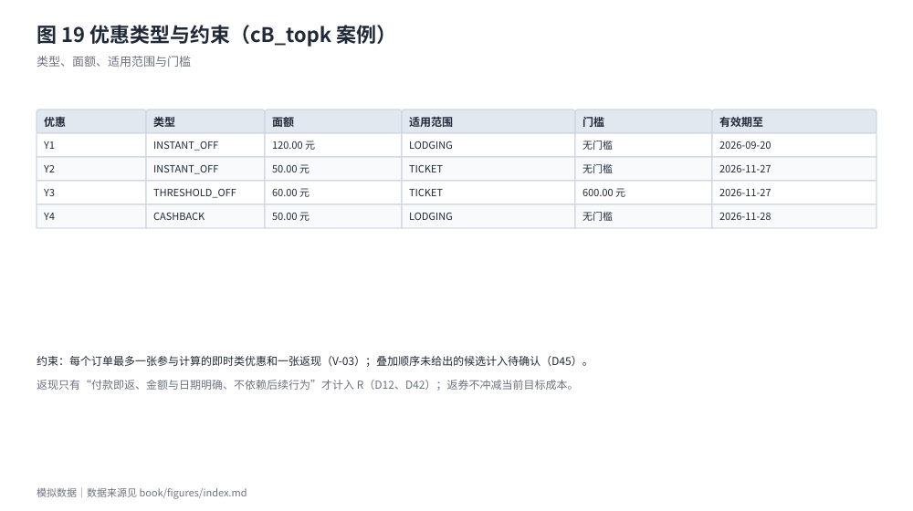

# 价格与优惠约束

## 价格依据的五档优先级

同一购买日按以下顺序取价（D13、D43）：有效模拟报价 ＞ 已确认的合格预测 ＞ 有效参考价（标"估算"）＞ 有效期未知的报价（标"估算"）＞ 待填。未确认的预测不属于第二档，取下一档并提示存在待确认的预测；有效期未知的报价只作估算，不当作有效报价。没有任何依据时不补造价格。

## 优惠的类型与计算

- 类型：立减、满减、折扣、返现、返券（D17、D45）。立减、满减、返现、返券的面额为整数分；折扣为万分比整数，9500 即 9.5 折。
- 基数：门槛与折扣以同一订单内 `scope` 所含项目的**优惠前小计**为基数；`scope` 是项目类别列表。
- 落地：一张即时类优惠在该订单内的减免额，只冲减该订单 `scope` 内价格项的付款；付款时刻不同时从最晚一笔开始冲减，相同时按价格项在数组中的顺序从后往前（D65）。
- 舍入：`rounding` 取 FLOOR、HALF_UP、CEIL 或 UNKNOWN；UNKNOWN 视为条件不完整，依赖它的候选只能计入待确认（R007、R011）。
- 叠加：同一订单叠加多张优惠必须由案例给出计算顺序，未给出则计入待确认。提交版演示数据另受 V-03 约束：每个订单最多一张即时类优惠与一张返现。
- 返现与返券：返现只有"付款即返、金额与日期明确、不依赖后续行为"才计入 R；返券不从当前目标成本中扣除（D12、D42）。

## 相容性约束

六类约束各自比较不同对象（D16、D44）：去程到达时刻与开演时刻、返程出发时刻与散场时刻、住宿须覆盖的入住日期列表、票档编码白名单、住宿距场馆的最大距离（整数米）、须可退的项目类别。候选违反任一已填写约束即确定性排除；约束已填写而候选缺少比较所需字段时，该候选计入**待确认数**而不排除——宁可说"还不知道"，也不误排除。

## 已有付款的项目

同一费用项目已有本目标付款时，候选中的价格项默认是"已购项目的另一报价"，不计入后续应付、也不在时间轴上付款；价格项带 `settles_event_id` 时表示它是该笔付款之后的未履行部分（如定金后的尾款），照常计入并付款（D75）。这条规则消解了"历史实付"与"后续待购"在数据上的歧义，也避免了重复生成待购。

## 失效与过期

关键报价过期、优惠条件无法评估或依赖未确定条件时，完整结论停止，不以估算替代（R009、D54 相关规则见第七章）。过期报价不会因为后来出现预测而"恢复"为有效报价。
