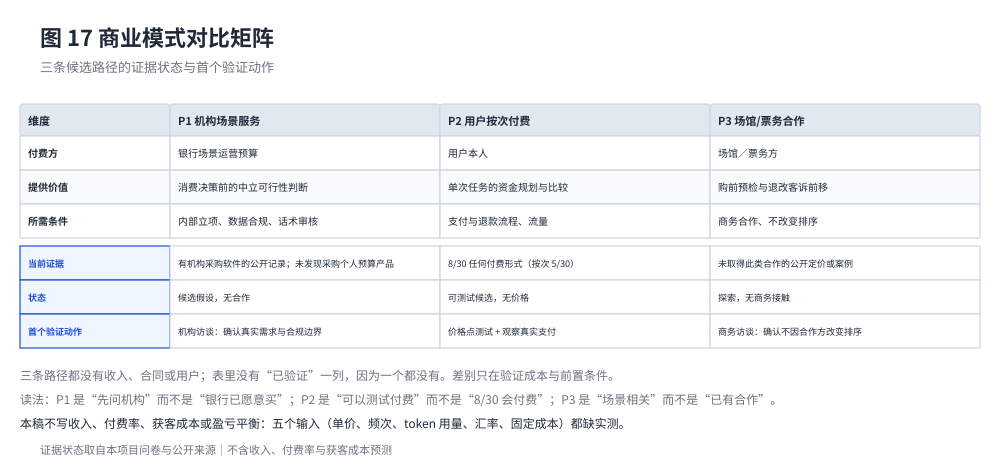

# 商业模式与市场进入策略

## 7.1 三条候选路径与初步优先顺序

产品定位是决策辅助层：不持有资金、不代付、不做授信。据此，商业模式只有三类可讨论的方向，且**都仍是待验证假设**，不存在已签署合作、试点客户或已确认收入。



图 17 把三条路径放在同一张对比表里，并显式列出"当前证据"与"首个验证动作"两行。表里**没有"已验证"这一列，因为一个都没有**；三条路径的差别只在验证成本与前置条件。

排序依据有两组证据：本项目问卷的样本内信号，以及外部产品的官方收费结构。两者都不能直接推出付费率，只用于判断"先验证哪一条"，因此顺序是 **P1（先问机构）→ P2（可测试个人付费）→ P3（探索场馆合作）**。

**读法必须精确**，这三个顺序最容易被读成结论：

- P1 是"先问机构"，**不是"银行已经愿意买"**。问卷里的"希望机构免费提供"5/30 是**用户对谁付钱的偏好**，与"机构愿意采购"是两件事；前者不能当作后者。外部证据也只支持一半：银行会为机构内部财务系统付费（有公开集采记录），但**没有任何公开证据**表明银行会采购面向个人的预算或资金规划产品。
- P2 是"可以测试个人付费"，**不是"8/30 会付费"**。问卷只问了付费方式，没有问任何价格点。
- P3 是"场景相关"，不是"已有合作"；本轮未取得此类合作的公开定价或案例。

外部价格证据对定价的启示同样有限：成熟市场的"前瞻规划"能力确实出现在付费档位里（例如某订阅产品把预测跨度写进档位，免费版限 6 个月；另一产品把前瞻预测放在高价档）[^C02][^C04]，这说明"可预见性"本身可以卖钱；但这套定价对应的是连接银行账户、覆盖多账户的长周期产品，与本项目"不连接账户、只做单次任务"的形态不同，**不能直接套用其价格**。

## 7.2 市场进入与渠道假设

| 渠道 | 触达方式 | 观察指标 | 当前状态 |
| --- | --- | --- | --- |
| 校园社团定向邀请 | 学生社团／学院合作 | 报名→完成一次规划的比例、放弃点 | 未落地 |
| 演出相关社群内容合作 | 内容说明 + 工具入口 | 入口点击→完成规划比例 | 未落地 |
| 场馆购前提示 | 购前页面／短信提示 | 提示点击率、规划完成率、误报申诉 | 未落地 |
| 银行 App 青年版块 | 银行场景入口 | 内部立项、合规评审、场景转化 | 未落地 |

四条渠道都未落地。本稿不写"已合作""已获客"，也不给获客成本或转化率数字。

渠道选择的基本判断是：**获客成本最低的入口在别人的场景里，而别人的场景需要商务关系**。这与 P1／P3 的验证成本高是一致的——这也是为什么本稿把"先做校园小范围试点"放在渠道动作的第一位：它不需要任何机构审批，就能验证"用户是否愿意为事前可行性多花一次操作"。

## 7.3 单位经济：已知数字与缺口分开

可复现的参数与公式在 `docs/_work/business_model.params.json`，由 `pnpm model:economics` 生成 `docs/_work/business_model.md` 与 `book/data/model/business_model.json`。该模型登记公开数字与计算公式，并把还没有数据的参数列为缺口；本节只采用其中的模型调用单价。

**已知数字（有公开来源）**：deepseek-flash 官方定价为输入 <!-- data: model/business_model.json#display.llm_input_usd_per_mtok_peak --> 美元／百万 token、输出 <!-- data: model/business_model.json#display.llm_output_usd_per_mtok_peak --> 美元／百万 token（高峰价，非高峰半价）[^E04]。

**公式（可以写清，但还不能代入）**：单次模型调用成本 = （输入 token ÷ 10⁶ × 输入单价 + 输出 token ÷ 10⁶ × 输出单价）× 人民币汇率。token 用量未实测、汇率未核验，因此本稿不给单次成本的数值。

**没有数据的参数（不设取值区间）**：单次价格、获客成本、年使用次数、年度固定成本、token 用量与汇率。本稿不生成价格、获客成本与使用次数的敏感性表：没有依据的档位代进正确公式也只是公式演示，不能证明盈利能力；缺口逐条登记在参数文件的 `open_items` 里。

有一点可以核实：演示与对拍使用离线回放，不调用模型，因此演示链路中的模型调用费用为 0。这是由代码路径与测试确认的系统性质，不是估算。

## 7.4 为什么不做收入预测

五类输入都不足，任何一种都不允许用"看起来合理"的数字补上：**价格**（问卷只问付费方式，8/30 任何付费形式、12/30 只用免费版，单选七类互斥合计 30/30，只能说明方式偏好）、**使用频次**（未测；"跨城观演 9/30"也不能当频次或市场规模）、**成本**（token 用量与汇率未实测，固定成本无数据）、**获客**（无投放或渠道数据）、**存量替代**（免费内置记账工具已把"记录与报表"做成零价格，把个人付费意愿的下限压得很低）。

因此本稿不给收入、贡献额、利润、投资回报或市场份额预测。若将来要算单个用户的贡献额，口径是"单次价格 × 年使用次数 − 单次模型成本 × 年使用次数 − 年度获客成本"；该口径不含固定成本、支付通道费、退款与客服成本，**不能称为毛利或净利润**。宁可少写一段，也不把示意参数写成结论。

## 7.5 与机构合作的合规边界

若将来推进机构路径，产品必须先守住四条，这些是前置条件而不是事后承诺：

1. **不因合作方偏好改变候选排序与结论**。排序规则写在引擎里，不接受机构配置。
2. **不在结论旁夹带贷款、分期或理财推荐**。产品不做交叉销售。
3. **不要求用户开立账户或授权真实流水**。数据最小化：只使用用户主动输入的字段。
4. **不承诺"一定可行"**。结论始终是"按当前假设可行"，并显示假设与限制。

这四条同时也限制了商业空间：越是坚持中立排序，越难把它包装成银行的营销工具。这一点必须诚实——它是产品定位的代价，也是它能被用户信任的前提。

## 7.6 面向银行的价值假设与试点口径

对银行（含工银亚洲）而言，价值目前只能写成待验证假设（`docs/policy_card.md` 第十节）：在用户授权、评估完成且接口可用的前提下，再研究账户信息能否减少录入成本、实际到账能否帮助更新计划、是否提升资金管理服务的持续使用与信任。问卷中"需要手动收集和输入太多资料"为 9/30，是第一条假设的样本内线索。

本轮不连接账户，单一账户的数据也不能当作用户完整的财务状况；本稿不预测银行收入、存款增长或消费增长（政策卡第十节）。

试点只看行为指标：优先观察计划更新、再次查看与下次真实目标复用，30 日留存只作补充。若做可归因的对照试点，按以下口径计算；增量不为正时，不计算单位增量留存成本。

```text
增量留存率         = 实验组留存率 − 对照组留存率
可归因新增留存人数 = 实验组纳入评估人数 × 增量留存率
单位增量留存成本   = 预先约定期间的新增投入 ÷ 可归因新增留存人数
```

三条公式都没有代入数值：留存率、人数与投入都要在试点中实测；试点前须写明有效使用、观察窗口与对照方法（政策卡第十节）。

[^E04]: DeepSeek API 官方定价页（Models & Pricing），2026-10-18 访问。核验记录见 `docs/sources.md` 的 E04。
[^C02]: Monarch 官方定价页及其常见问题（访问 2026-10-19）。见 `docs/sources.md` 的 E21（C02）。
[^C04]: PocketSmith 官方定价页（访问 2026-10-19）。见 `docs/sources.md` 的 E23（C04）。
