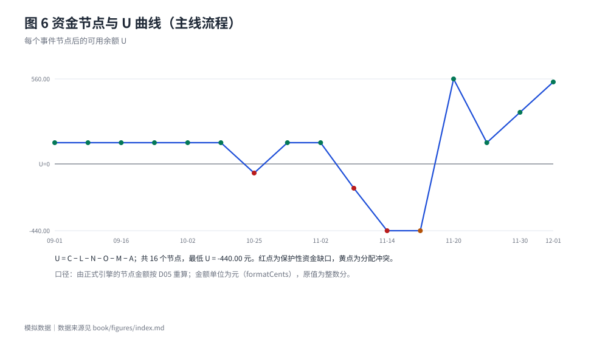
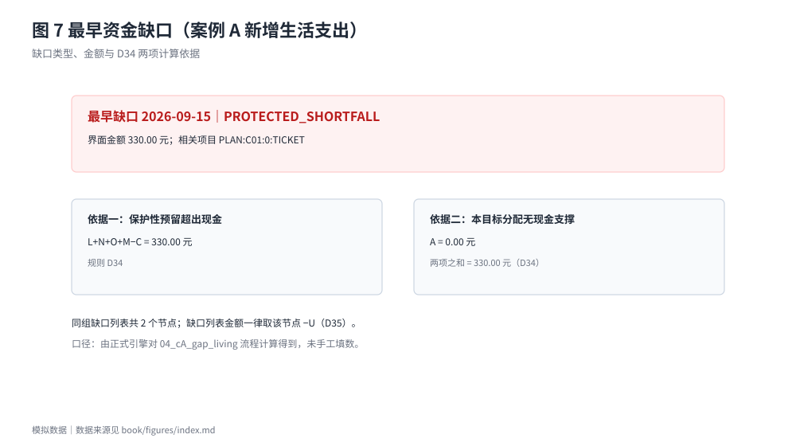
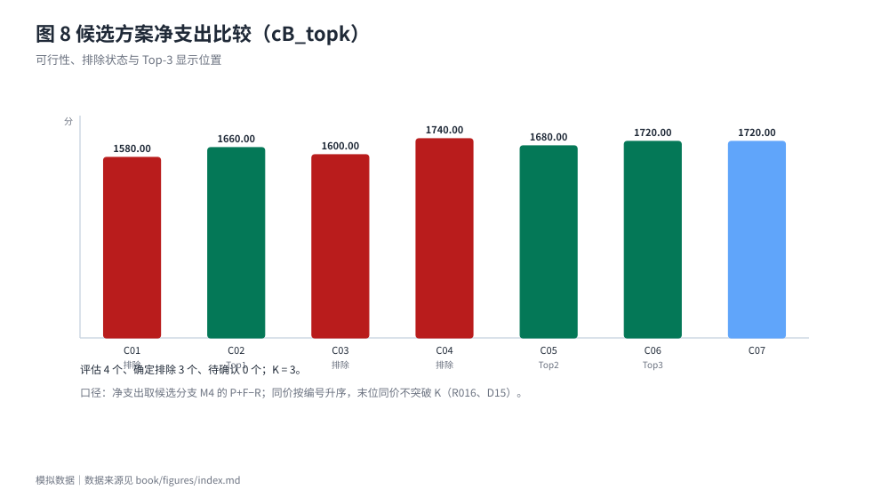
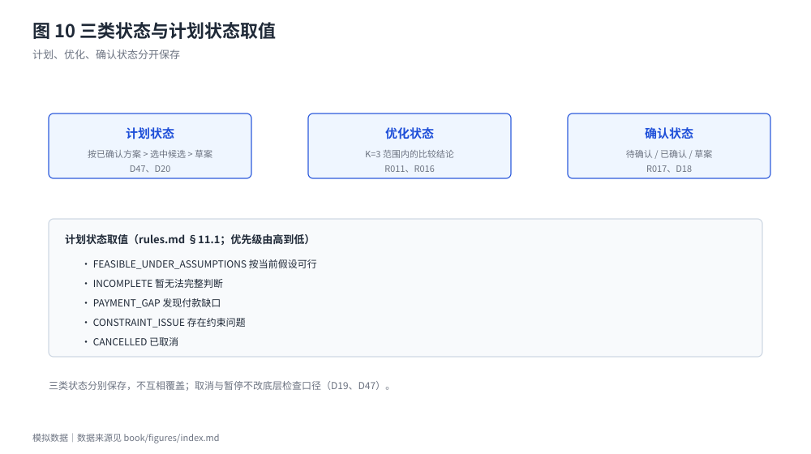

# 资金时间轴与可行性判断

## 快照与时间轴

`as_of` 与 `cash_as_of` 一律使用带 +08:00 偏移的时刻；快照阶段只取 DAY_START、AFTER_EVENT(n)、DAY_END 三种，并与各事件的 `in_snapshot` 核对（D03、D51）。已实际发生且不晚于 `cash_as_of` 的事件必须计入快照；快照阶段与计入标记不符按输入冲突处理。

检查期间起点为 `as_of`，终点先取"最后一笔目标相关收付款日"与"其后第一笔已确认收入到账日"的较晚者，再与基础时间轴最晚一笔 OTHER_EXPENSE 日期取较晚者，仍受 2027-01-01 限制（D04、D41、D56）。超出范围不是截断，而是"暂无法完整判断"。

## 同日顺序

同日先后只认案例显式给出的 `known_order`；事件自带时刻不决定先后。未知顺序时，流出排在不能确定已到账的流入之前；多笔流出先后未知时报告日级累计缺口而不指认具体哪笔先失败；共用同一预留且声明覆盖合计超额时按输入冲突处理（D10、D38）。机动预留释放排在当日全部收付之后，收入引起的预留建立与计划分配转入紧随该收入。

## 资金节点与缺口

上图为主线流程每个节点后的 U。判定与缺口分类见第三章。最早缺口除了金额，还给出两项依据（保护性预留超出现金、本目标分配无现金支撑），二者之和等于 −U。

案例 A 新增一笔生活支出后出现最早缺口：日期 <!-- data: flows/04_cA_gap_living.json#checkpoints.0.result.earliest_gap.at -->，金额 <!-- data: flows/04_cA_gap_living.json#checkpoints.0.result.earliest_gap.amount.value | cents --> 元，类型 <!-- data: flows/04_cA_gap_living.json#checkpoints.0.result.earliest_gap.node_verdict -->，与节点 <!-- data: flows/04_cA_gap_living.json#checkpoints.0.result.earliest_gap.node_index --> 对应。

## 每日参考金额的限制节点

每日参考给出的金额来自"取满足检查的最大整数分 x"，它的限制来源用 `daily_reference.limited_by` 标明：`scenario` 是起限制作用的情景，`node_index` 是**本检查点返回的 `ResultCore.nodes[]` 数组中的零起始下标**（`nodes[0]` 是起始节点，§12.7（25）、D26、R019 第7条）。

需要单独说明的是它**不是**内部探测时间轴的下标：探测待测额 x 时，x 的节点插在起始节点之后，所以同一个限制节点在探测时间轴上会比在 `nodes[]` 里靠后一位。以 T019-01 为例，`nodes[]` = 起始节点、9/10 付款节点、9/15 生活支出；`limited_by.node_index` 为 1（指向 9/10 付款节点），而 `x = D+1` 的探测时间轴上该节点是第 3 个（下标 2）。两种口径不能混用，单元测试直接断言"下标在 `nodes[]` 里指向限制节点本身，且不等于探测时间轴的下标"。

该口径已由人工裁决写回正式条文，本轮 `pnpm diff:oracle` 与参考实现的差异为 <!-- data: status.json#oracle_diff.differences -->。此前工作记录里"参考实现按探测时间轴计数、与本实现差 1"的差异**本轮未复现**：30 个含 `daily_reference.limited_by` 的向量逐字段比对，`node_index`、`scenario`、`display`、`amount` 完全一致，因此不再作为当前事实陈述；只有出现"限制节点的 `nodes[]` 下标与探测时间轴下标不同"且参考实现按探测时间轴计数的案例才会再次触发。

## 候选比较与 Top-K

候选完整组合由案例直接列出，程序只做校验、排除与排序，不做排列组合生成（D15）。可行候选按预计消费净支出升序编号并从 1 起连续，同价同号；显示位置取前 K 名，同价按编号升序，末位同价不突破 K（R016、D62、SG-62）。三类计数互斥：通过检查计入已评估数，确定排除计入确定排除数，其余计入待确认数，合计等于比较范围。

案例 `cB_topk` 的比较范围为 <!-- data: cases/cB_topk.json#checkpoints.0.result.optimization.scope.0 -->—<!-- data: cases/cB_topk.json#checkpoints.0.result.optimization.scope.6 -->：已评估 <!-- data: cases/cB_topk.json#checkpoints.0.result.optimization.evaluated_count --> 个、确定排除 <!-- data: cases/cB_topk.json#checkpoints.0.result.optimization.excluded_count --> 个、待确认 <!-- data: cases/cB_topk.json#checkpoints.0.result.optimization.pending_count --> 个，K = <!-- data: cases/cB_topk.json#checkpoints.0.result.optimization.top_k -->。

## 暂停、取消与逾期

暂停不释放资金，主状态显示"已暂停"，底层检查仍按已确认方案计算；取消只释放尚未使用的 A，不增加现金，M 仍在活动结束次日日终释放（D09、D47、D55）。已取消的底层检查只计仍有效的义务与生活安排，`cancellable` 为 true 的流出不再计入。任一逾期未履行的预计事件使计划状态为"暂无法完整判断"：局部检查中逾期流出改在 `as_of` 发生，逾期流入不计入（D54）。

## 三类状态

计划状态、优化状态与确认状态分别保存，不互相覆盖。
