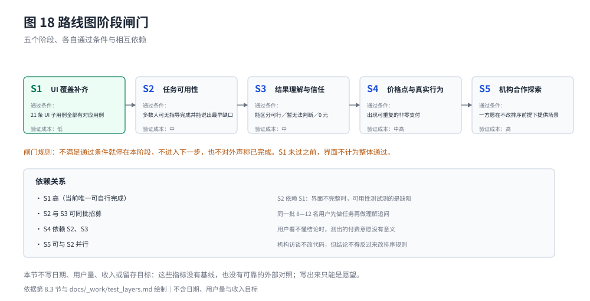

# 实施路线图、团队与风险

## 8.1 已完成的阶段

- **M1—M9 确定性引擎**：资金分区、时间轴、预留核销、成本与优惠、候选比较、确认与行动清单、每日参考、消费情景、价格预测全部实现，配置版本 DEMO-CFG-1。
- **验证体系与生成链路**：测试向量、单元测试、golden 冻结、参考实现对拍、规格自洽、追溯表与测试报告；结果导出、图表、文档检查、篇幅统计、成稿构建与 A4 排版（`pnpm book:pdf`）全部脚本化，可整体重跑。
- **界面与主流程**：四页界面已合入主线，端到端 17 条 spec 通过（主流程 1 条、带子用例编号的 13 条、补充断言 3 条）。
- **问卷与方法论**：题面、字段规范、清洗口径与统计脚本已就绪；首轮 30 位受访者（n=30）已完成分析，只作探索，不代表总体。
- **外部研究**：本轮补充演出行业、青年人口与在校生规模、竞品官方定价、机构采购与往期作品等公开证据，逐条记入附录 D。

## 8.2 团队与分工

官方赛事指引要求：团队总人数不超过 3 人、需指定团队长、每名选手最多提交一个作品、正式提交者须为在校大学生[^GHX]。封面列出院校与 3 名成员；本节只按角色说明当前工作，不新增未经核实的履历、奖项或头衔，成员信息最终以赛事报名系统为准。

| 角色 | 当前承担的工作 | 已有产物 | 主要缺口 |
| --- | --- | --- | --- |
| 陈冠达（队长／产品与规则） | 需求定义、规则 R001—R020 与 D01—D88、范围与验收 | `docs/rules.md`、`docs/policy_card.md`、`docs/scope.md` | 真实用户访谈、价格测试 |
| 张烙华（计算与测试） | 资金分区、时间轴、候选比较、确认与分配额、预测；向量与对拍 | `src/engine/`、`fixtures/vectors/`、`tests/unit/`、对拍报告 | 结果契约的类别 B 缺口 |
| 刘博文（原型实现） | 四页界面、状态展示、端到端用例 | `src/App.tsx`、`tests/e2e/` | UI 层 5 条子用例未覆盖 |
| 团队共同（研究与文档） | 问卷、市场与案例研究、项目书、审计与生成链路 | `docs/_work/`、`book/`、`scripts/` | 扩样、竞品实测、机构访谈 |

分工以团队内部约定与报名系统为准。团队目前**没有银行合作、试点客户或付费用户**，相关角色只承担验证准备，不承担"已落地"的对外承诺。

## 8.3 下一阶段：以可验证里程碑为主

路线图不写用户量、收入或留存目标——这些指标没有基线，写出来只能是愿望。五个阶段各自有明确的**决策条件**，不满足就停在上一步。

图 18 把五个阶段画成闸门而不是时间轴，原因是**先后关系由依赖决定，不由日期决定**：S1 是当前唯一可以完全自行完成的动作（补 UI 覆盖），S2／S3 必须在界面完整之后才测得有意义，S4 依赖前两阶段，S5 可与 S2 并行但不得反过来修改排序规则。图里没有日期，因为任何日期都会是编造的。

| 阶段 | 目标 | 主要动作 | 通过条件（全部满足才进入下一阶段） | 不通过时怎么办 |
| --- | --- | --- | --- | --- |
| S1 补齐高风险 UI 覆盖 | 界面不再"部分通过" | 为 5 条未覆盖子用例补界面展示位置或改用契约级断言；把 3 条部分覆盖改为与子用例一一对应 | 21 条 UI 子用例全部有对应用例；`pnpm test:e2e` 与追溯表状态一致 | 停在 S1，不对外声称界面通过 |
| S2 任务可用性 | 用户能否独立完成一次规划 | 8—12 名目标用户，无主持、只给任务卡；记录完成率、放弃点、误读点 | 多数参与者能在无指导下完成一次规划，且能正确说出"最早哪天差钱" | 若卡在"补信息"环节，先改引导与默认值策略再测 |
| S3 结果理解与信任 | 用户是否看得懂并据此行动 | 同一批用户看演示案例（模拟数据）的结果，追问"你会怎么做" | 用户能区分"可行""暂无法完整判断""0 元"三种状态 | 若混淆集中在词汇，改文案后重测；若集中在逻辑，回改机制 |
| S4 价格点与真实行为 | 是否存在可付费的价格带 | 3—4 个价格点的选择实验 + 一次可支付的小范围试用 | 出现可重复的非零支付行为，且退款率在可接受范围 | 无支付行为则回到机构路径（P1）或维持免费工具定位 |
| S5 机构合作探索 | 机构路径是否值得投入 | 校园渠道 2 家、场馆 1 家、银行 1 家的探索性访谈 | 至少一方愿意在不改变排序结论的前提下提供场景 | 任一方要求调整结论即终止该方向 |

S2 与 S3 是当前最关键的两步：技术验证已经足够支撑一次可用性测试，缺的是真实用户坐下来使用。

## 8.4 风险与应对（摘要，完整台账见附录 E.1）

**完整风险台账（10 条）在附录 E.1**，逐条写证据状态、触发条件、影响、缓解与责任线。主文只点出四条会直接改变评审判断的：**客户需求与付费意愿未验证**（n=30 便利样本，付费只有方式偏好，正文因此只写"在这批受访者中"）；**个人资料与问卷隐私**（隐私是首要顾虑 16/30，不连接账户、原始答卷不入库，香港适用要求未评估前不接真实数据）；**样本与外部数据口径失真**（只用符号化乘法式，附录 D 每条写年份、地域与口径）；**结论被当作消费建议或安全额度**（文案固定为"按当前假设可行"，排序不接受合作方配置）。其余六条见 E.1。

## 8.5 香港适配路线图

香港赛区的落地问题分五项推进（`docs/rules.md` §8.7 C5）：港币单币种、跨币支付、工银亚洲公开资料、香港用户任务测试、个人资料与模型调用。**每项的当前状态、下一步与进入下一步的条件列在附录 E.4**，本节只给结论性判断：前两项涉及 R008 的币种边界，必须先修订规则再改代码与测试；后三项不改计算口径，可以先做。

本轮在这一侧的诚实表述是：**只接受人民币**（R008），香港用户任务测试尚未开始，工银亚洲公开资料未核验，因此本稿不声称已支持港币、也不声称已量化香港市场规模。香港赛区总决赛计划于 2026-11-27 举行（`docs/sources.md`「香港赛区」）；现场演示只用已通过端到端测试的主流程，未完成的项目如实标注。

## 8.6 参赛与提交材料

- **参赛资格**：香港赛区面向香港全日制大学学生，每组 1—3 人并指定 1 名队长（`docs/sources.md`「香港赛区」）；每名选手最多提交一个作品[^GHX]。本队 3 人，来自香港理工大学，成员信息以报名系统为准。
- **原创**：作品须原创，严禁抄袭、造假或权属纠纷[^GHX]；往期作品只用于研究方法（6.7 节），模拟案例数据的生成方式见 5.7 节。
- **篇幅与格式**：作品名称、作品概述（≤500 字）、附件与产品建议（≤500 字）四项来自仓库内的提交说明摘录（`docs/sources.md`「目前需要提交的内容」，该摘录**原文未标链接与发布日期**）。同一摘录还写"附件大小在 20M 内，接受 doc、docx、ppt、pptx、pdf"，但本轮实际打开的官方页面（GH01、GH03、GH04）**均未公布文件格式与大小限制**[^GHX]，因此本稿把"≤20MB、PDF"当作**团队自设的文件控制标准**，而不是官方要求：当前 PDF 约 6.2MB、格式为 PDF，在自查标准内；提交时仍须以提交页面的实际提示为准。官方页面同样未公布章节模板、页数与评分权重，本稿的约 40—50 页只是编辑目标。

[^GHX]: 工行杯官方页面与通知：大赛介绍（GH01）、作品提交截止日期通知（GH03）、赛事指引（GH04），访问 2026-10-19。见 `docs/sources.md` 对应条目；官方未公开章节模板、页数、文件格式与评分标准。
