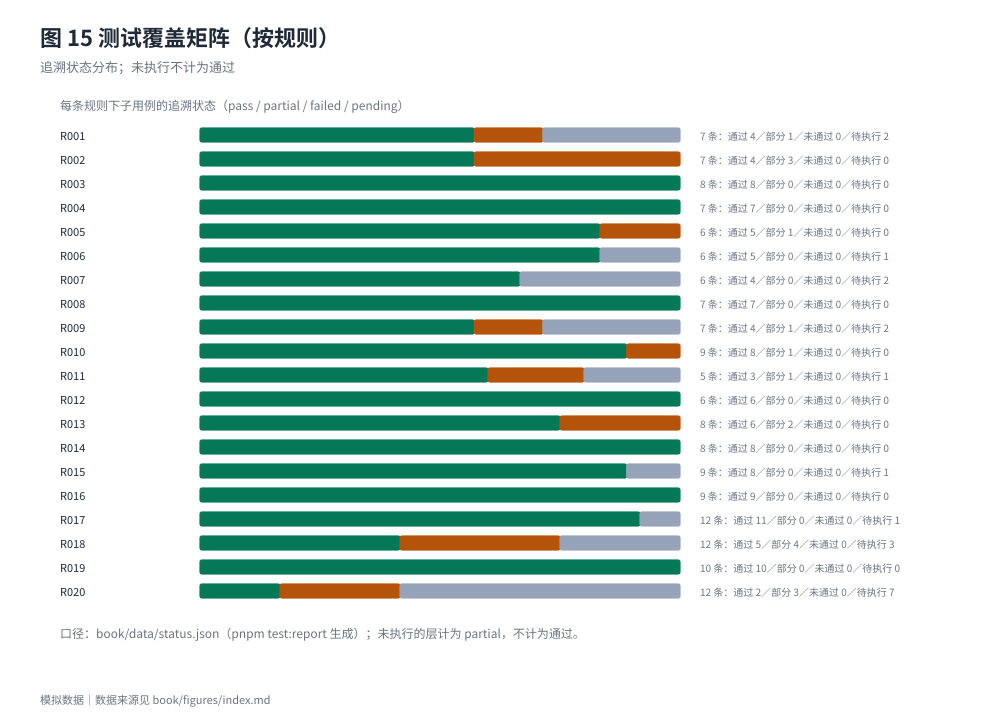
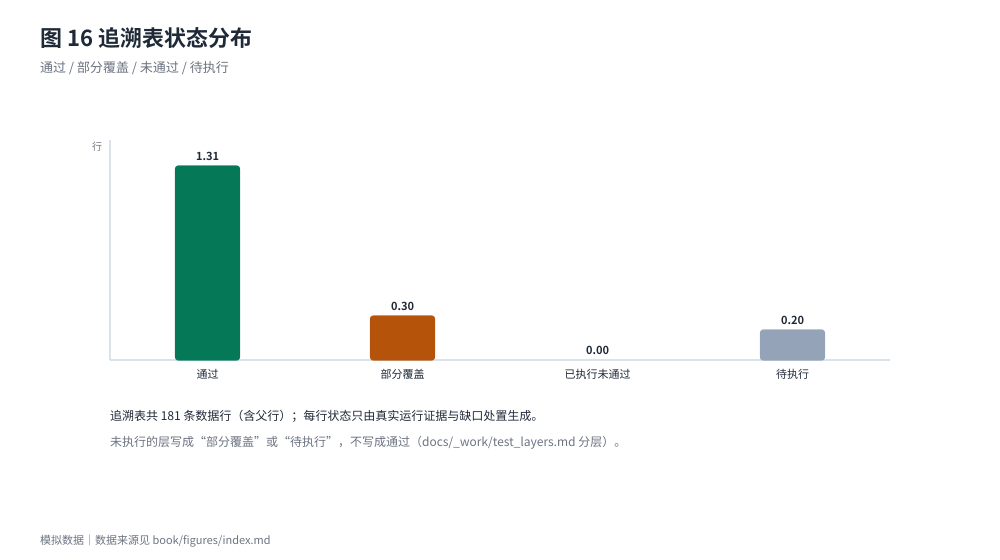

# 技术验证与局限性

## 已验证的部分

- **确定性**：同一输入与配置重复执行结果逐字节相同；金额全程整数分，不使用浮点（R007）。
- **规则—实现—测试一致**：R001—R020 的 161 条子用例登记在追溯表中；已执行的向量、单元测试与文档检查结果由 `pnpm test:report` 汇总（附录A）。当前测试口径：单元测试通过 <!-- data: status.json#unit.passed --> 条（跳过 <!-- data: status.json#unit.skipped --> 条），测试向量 <!-- data: status.json#vectors.vectors_total --> 个、断言 <!-- data: status.json#vectors.assertions_total --> 条，失败 <!-- data: status.json#unit.failed --> 条。
- **与独立参考实现对拍**：参考实现按同一规则独立实现，逐检查点比对；本轮的差异数为 <!-- data: status.json#oracle_diff.differences -->，比较的检查点 TS <!-- data: status.json#oracle_diff.checkpoints_ts --> 个、参考实现 <!-- data: status.json#oracle_diff.checkpoints_oracle --> 个。
- **golden 冻结**：案例与流程的全部检查点被冻结，任何计算结果变化都会使 `golden:check` 失败，必须走人工审批流程（`golden:freeze` 只允许人工运行）。
- **数据约束**：`validate:cases` 校验案例与向量的结构、禁用词、日期范围与提交版数据约束（V-01—V-07）。

## 当前覆盖的真实状况

追溯表共 <!-- data: status.json#traceability.rows --> 条数据行：通过 <!-- data: status.json#traceability.pass -->、部分覆盖 <!-- data: status.json#traceability.partial -->、已执行未通过 <!-- data: status.json#traceability.failed -->、待执行 <!-- data: status.json#traceability.pending -->。**"部分覆盖"与"待执行"不折算为通过**：它们对应 UI 层尚未逐条覆盖的端到端子用例，以及结果契约里没有对应字段、只能由单元测试或人工复核的断言。

## 局限

1. **界面与端到端只部分验收**：四页界面已合入主线，`pnpm test:e2e` 有 1 条 Playwright spec 覆盖"看方案比较 → 选择 C02 → 确认 → 看资金日历"这一条主流程并实际通过；但追溯表里 UI 层共 21 条子用例，**没有被 21 条端到端用例逐条覆盖**，spec 数与 UI 子用例数不是一回事。四页真实截图已由 `pnpm shots` 生成并在 `submission/screenshots/` 单独交付，本稿正文未插入任何截图，也不以截图代替复现证据。
2. **自然语言的确认方式（方案 A，已裁决）**：抽取→追问→草稿→逐字段确认→重建输入版本→重算已实现并可离线回放，确认值会写入案例输入的 `confirmations[]` 并参与判断；"在一次会话内追加确认并自动加版本"（方案 B）需要新增流程操作、属正式数据契约变更，**已裁决不启用**，如将来需要须单独授权（见第八章与 `docs/_work/spec_gaps_review.md`）。
3. **结果契约的表达力**：部分断言（如无日均参考字段、无待确认差异字段、价格依据不逐项输出）无法写成向量，只能由单元测试覆盖或明确登记为缺口（`docs/_work/vector_gaps.md`），不通过修改预期值来"消除"缺口。
4. **预测方法简单**：Holt 阻尼趋势只在少量样本上评估，结论限定为"按当前假设"，不构成价格承诺；历史不足时不给预测。
5. **用户价值仅部分支持**：30 条有效提交（便利样本）显示资金问题普遍（22/30）、焦虑 17/30、多方案比较 13/30、隐私 16/30；但跨城观演仅 9/30、付款日错配 4/30、任何付费形式 8/30，且无实际使用、留存、价格与 CAC 数据。样本以香港/内地学生为主（18—20 岁 22/30，含 4 名 `<18`），不能外推为全国青年。
6. **原"AI 暂定项"已全部写回正式规则，但影响面不同**：14 条中的 SG-68 与 13 条保守读法已逐条裁决并写入 `docs/rules.md`（§8.8 的 D78—D88、§10.5、§12.7（25）），不再有待复核定级项。它们**不是**同一类"只影响第 12 位小数"的问题：SG-47 只影响 12 位小数的中间量舍入；SG-48、SG-49、SG-70、SG-74 决定预测与情景能否给出、给什么状态；SG-64、SG-65、SG-66 决定确认能否写入与任务状态；SG-68、SG-75 影响对外输出的下标与顺序；SG-72 决定情景分组金额与舍入；SG-71、SG-73 决定数据冲突与当日记账口径。

## 复现方式

全部结果可由仓库内的受控输入重建：`pnpm test:report` 生成附录A 与计数，`pnpm export:results` 生成 `book/data`，`pnpm model:economics` 复算市场与单位经济模型，`pnpm survey:report` 从脱敏分析数据复算问卷统计，`pnpm figures` 生成图表，`pnpm doc:lint`、`pnpm count:chars`、`pnpm book:build` 依次检查并合成成稿。步骤与环境要求见附录B。
