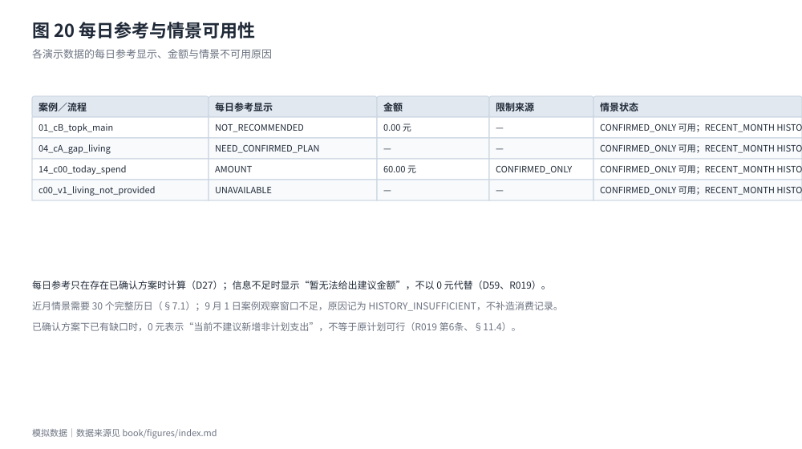
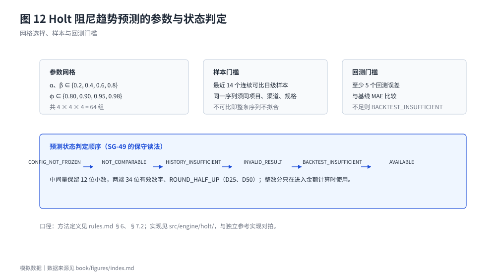
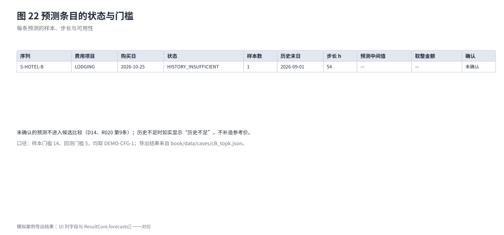

# 附录 A　规则与关键算法细节

本附录是主文的实现说明，不重复论证。全部条文以 `docs/rules.md` 为准；此处只摘录与计算直接相关的定义、判据与边界，便于评审与复核者逐条对照。

## A.1 资金分区与节点判定

把现金 C 分成五部分：生活预留 L、机动／应急预留 M、其他保护性预留 N、第二目标固定占用 O、本目标分配 A。定义：

```text
G = C − L − N − O        本目标可用
H = G − M                付款空间
U = H − A                未分配资金
```

每个节点依次判定（D05、D36）：

1. **保护性资金缺口**：L + N + O + M > C。界面金额为该节点的 −U，并分列两项依据——"保护性预留超出现金"（L + N + O + M − C）与"本目标分配无现金支撑"（A），两项之和等于 −U（D34）。
2. **否则若 U < 0**，按引起 U 下降的原因归类：
   - 出现在快照、用户修改分配或预留之后 → **分配冲突**；
   - 出现在某笔流出之后 → **付款缺口**，相关项目为该笔流出；
   - 收入节点因建立生活预留（D08）或计划分配转为 A（D18）而首次出现 U < 0 → 分配冲突（D37）。
3. **其余为通过**。

**本金与覆盖的核销顺序**：本目标付款先按覆盖关系核销预留 q（每项不超过对应剩余额），剩余部分 r = x − q 先冲减 A，仍不足才使用未分配资金；不属于本目标的支出只能用未分配资金，不得挪用 A 或保护性资金（D06、D07）。因此 A 会随目标付款逐笔减少，付款后若 A 已归零，则 U = H。

**最早缺口**：只取检查期间内第一个保护性资金缺口或付款缺口；U 已为负但未继续下降的节点标"缺口延续"（GAP_CONTINUED／CONFLICT_CONTINUED），金额一律为该节点 −U（D11、D35）。缺口列表与最早缺口分开保存。

## A.2 快照、检查期间与截断

- 时点一律使用带 +08:00 偏移的时刻；快照阶段只取 DAY_START、AFTER_EVENT(n)、DAY_END 三种，并与各事件的 `in_snapshot` 核对（D03、D51）。已实际发生且不晚于 `cash_as_of` 的事件必须计入快照，不符按输入冲突处理。
- 检查期间起点为 `as_of`，终点先取"最后一笔目标相关收付款日"与"其后第一笔已确认收入到账日"的较晚者，再与基础时间轴最晚一笔 OTHER_EXPENSE 日期取较晚者，仍受 2027-01-01 限制（D04、D41、D56）。
- 超出范围不是截断，而是"暂无法完整判断"；检查期间不完整时不得给出可行结论。
- **局部截断（D74）**：第一笔金额或日期未知的流出处截断检查，同组的流出一并不执行；日期未知的无法定位，在起始节点之后截断。

## A.3 同日先后

同日先后只认案例显式给出的 `known_order`，事件自带时刻不决定先后（D10）。

- 未知顺序时，流出排在不能确定已到账的流入之前。
- 多笔流出先后未知时，按流出组在组末统一判定，报告日级累计缺口而不指认具体哪笔先失败（D38）。
- 共用同一预留且声明覆盖合计超额时，按输入冲突处理，不报告该日的日级缺口。
- 机动预留释放排在当日全部收付之后；收入引起的预留建立与计划分配转入紧随该收入。

## A.4 成本、价格依据与优惠

**净支出**：按候选分支计算 P（已付）+ F（后续应付）− R（可计入的返还）；优惠按订单落到具体付款上（D45、D65）。返现只有"付款即返、金额与日期明确、不依赖后续行为"才计入 R；返券不从当前目标成本中扣除（D12、D42）。

**价格依据五档**（D13、D43）：有效模拟报价 ＞ 已确认的合格预测 ＞ 有效参考价（标"估算"）＞ 有效期未知的报价（标"估算"）＞ 待填。未确认的预测不属于第二档，取下一档并提示存在待确认的预测；没有依据时不补造价格。

**优惠类型与计算**（D17、D45）：

- 立减、满减、返现、返券的面额为整数分；折扣为万分比整数，9500 即 9.5 折。
- 门槛与折扣以同一订单内 `scope` 所含项目的优惠前小计为基数。
- 一张即时类优惠的减免额只冲减该订单 `scope` 内价格项的付款；付款时刻不同时从最晚一笔开始冲减，相同时按价格项在数组中的顺序从后往前（D65）。
- `rounding` 取 FLOOR、HALF_UP、CEIL 或 UNKNOWN；UNKNOWN 视为条件不完整，依赖它的候选只能计入待确认（R007、R011）。
- 同一订单叠加多张优惠必须由案例给出计算顺序，未给出则计入待确认。提交版演示数据另受 V-03 约束：每个订单最多一张即时类优惠与一张返现。


**已有付款的项目**（D75）：同一费用项目已有本目标付款时，候选中的价格项默认是"已购项目的另一报价"，不计入后续应付、也不在时间轴上付款；价格项带 `settles_event_id` 时表示它是该笔付款之后的未履行部分（如定金后的尾款），照常计入并付款。

**失效与过期**：关键报价过期、优惠条件无法评估或依赖未确定条件时，完整结论停止，不以估算替代（R009、D54）。过期报价不会因为后来出现预测而"恢复"为有效报价。

## A.5 相容性约束

六类约束各自比较不同对象（D16、D44）：

| 约束 | 比较对象 |
| --- | --- |
| 到达时刻 | 去程到达时刻与开演时刻 |
| 返程时刻 | 返程出发时刻与散场时刻 |
| 住宿覆盖 | 住宿须覆盖的入住日期列表 |
| 票档 | 票档编码白名单 |
| 距离 | 住宿距场馆的最大距离（整数米） |
| 可退性 | 须可退的项目类别 |

候选违反任一**已填写**约束即确定性排除；约束已填写而候选缺少比较所需字段时，该候选计入**待确认数**而不排除——宁可说"还不知道"，也不误排除。

## A.6 候选比较与 Top-K

- 完整候选组合由案例直接列出，程序只做校验、排除与排序，**不做排列组合生成**（D15）。
- 可行候选按预计消费净支出升序排列；进入前 K 名的从 1 起编号、不重复、不缺号，不在前 K 名的编号为空；同价并列标注，按候选编号升序截取，末位同价不突破 K（R016 第 7 条、§12.7）。案例 B 中 C06 与 C07 同为 1720.00 元，C06 排第 3，C07 不显示（图 8）。
- 三类计数互斥：通过检查计入已评估数，确定排除计入确定排除数，其余计入待确认数，合计等于比较范围。

## A.7 确认、建议分配额与行动清单

**确认链路**（R017、D29、D63）：

1. `SELECT_CANDIDATE` 只改变"当前选中的候选"，不写入正式安排、不增加输入版本（D29、SG-32）。
2. 确认时按 D46 计算建议分配额 ΔA 与计划分配。
3. `CONFIRM` 写入正式安排时输入版本加 1；只存草案时不加。重复提交同一确认（同一候选、同一方案版本、同一输入版本且主记录仍是该方案）不重复写入、不加版本。
4. 确认时按当时数据冻结任务编号、渠道、购买日、付款日与优惠；之后风险与可行性按当前输入重算，清单不自动改变（R017 第 8—10 条、D77）。
5. 输入变化后，早于当前版本的确认记录标"需重新确认"，不直接用于判断（D60）。

**建议分配额 ΔA 的完整定义**（D18、D46）：

```text
W  = 剩余计划目标付款中未被预留覆盖的部分
m  = 确认前模拟（含该候选付款、不含新增分配与消费情景）中
     检查期间全部节点 U 的最小值（含快照节点）
ΔA = [0, max(0, W − A0)] 内使「确认后模拟中全部节点 U 的最小值 ≥ m」
     成立的最大整数分；条件随 ΔA 单调，用二分求解
验收：ΔA 满足条件，且 ΔA 小于上界时 ΔA + 1 不满足
计划分配：只建一笔，金额在 ΔA 确定后按同一条件取最大值，
         上限 max(0, W − A0 − ΔA)；仍未分配的部分注明"届时由未分配资金支付"
```

确认后 A = A0 + ΔA。**关键性质**：ΔA > 0 时，凡 A 仍然有效的节点，其 U 都会等额下降 ΔA；被保护的是"全部节点 U 的最小值"，不是每一个节点。由于每日参考 D 等于该最小值（U 非负时），这一约束等价于"今日可额外支出不减少"。

**可核对的节点级例子（向量 T017-04，已冻结）**：A0 = 0，W = 850.00，m = 200.00，ΔA = 300.00，计划分配 550.00 挂在 9/20 收入上。

| 节点 | 确认前 A（元） | 确认前 U（元） | 确认后 A（元） | 确认后 U（元） | U 变化 |
| --- | --- | --- | --- | --- | --- |
| 起始（快照） | 0.00 | 500.00 | 300.00 | 200.00 | −300.00（= ΔA） |
| 9/5 目标付款后 | 0.00 | 200.00 | 0.00 | 200.00 | 0 |
| 9/20 收入到账后 | 0.00 | 800.00 | 550.00 | 250.00 | −550.00（计划分配转入 A） |
| 9/25 目标付款后 | 0.00 | 250.00 | 0.00 | 250.00 | 0 |
| **检查期间最小 U** | — | **200.00** | — | **200.00** | **0** |

若按"每个节点 U 都不降低"的读法，此例只能得 ΔA = 0，与条文、实现和该向量的断言都不符；按"最小 U 不降低"的读法，ΔA = 300.00 是唯一满足条件的最大值（ΔA = 301.00 会使起始节点的 U 降到 199.00，低于 m）。**快照节点本身是最小值时，ΔA 必然为 0。**

**行动清单字段**：任务编号为"候选:价格项序号"；任务状态在本版恒为"待购买"，因为案例中没有把购买记录关联到任务的字段（SG-66）。不列入已购项目的另一报价（D75）、确认免费与不适用的项目；取消后 `cancellable` 为 true 的价格项不再显示。

清单同时给出该任务涉及的优惠与需要复核的条件：价格依据不是有效期内的报价、为估算或金额未知时提示复核价格；用了优惠或依据预测估算时提示复核优惠条件（R017 第 7 条、§12.7）。

**待确认差异**：新估算只取已确认价格项按当前输入重算的金额，与确认时冻结金额不同时按费用项目汇总差额，行动清单不变；其他候选的价格（含未经确认的预测）不计入（D77）。

## A.8 每日参考与消费情景

**每日非计划支出参考 D**（R019、§4、§10.5）：不用余额或日均数，而是在完整检查期间上探测——寻找最大的整数分 x，使"今天多花 x 元"之后资金时间轴仍然全部通过。约束为 x ≤ U0（快照节点未分配资金），因此 x=0 即不通过时不计算 D。

三种显示：给出金额（附说明：按当前输入和假设测算，不构成资金安全承诺）、"当前不建议新增非计划支出"（0 元不等于原计划可行）、"暂无法给出建议金额"（信息不足，不以 0 代替）。

限制来源用 `daily_reference.limited_by` 标明：`scenario` 是起限制作用的情景，`node_index` 是**本检查点返回的 `ResultCore.nodes[]` 数组中的零起始下标**（`nodes[0]` 是起始节点，§12.7（25）、D26、R019 第 7 条）。它不是内部探测时间轴的下标：探测待测额 x 时，x 的节点插在起始节点之后，所以同一节点在探测时间轴上会比在 `nodes[]` 里靠后一位。两种口径不能混用。

**近月情景**（D23、D49、D67）：组总额 Pg = 观察窗口合计 × 组内天数 ÷ 30，一次取整；增量 Δg = max(0, Pg − Eg)，有已知付款日时按付款日安排，没有才在组内各日平均分摊。历史不足或类别标注不清时情景不可用，给原因不给金额（D26）。

9 月 1 日案例的观察窗口不足 30 个完整历日，因此近月情景不可用、原因记为 HISTORY_INSUFFICIENT，主展示按"仅已确认安排"给出并注明限制来源；系统不通过补造消费记录来凑出可用情景。



图 20 中 `01_cB_topk_main` 一行取收入延期之后（v3）的检查点，所以显示"当前不建议新增非计划支出"（0.00 元）；同一方案在确认后、延期前为 140.00 元（`book/data/flows/02_cB_topk_reconfirm.json` 第 1 次确认，见 3.6 节）。

## A.9 价格预测：Holt 阻尼趋势

- 模型：水平项与趋势项递推，预测式含阻尼幂和；α、β、φ 在有限网格上选取，比较训练 SSE，同值按 α、β、φ 升序取第一组（§6、§7.2）。
- 数值：中间量每步保留 12 位小数，两端 34 位有效数字、ROUND_HALF_UP；整数分只在进入金额计算时使用（D25、D50）。实现用 decimal.js，参考实现用 Python decimal，逐值对拍。
- 门槛：起点前至少 14 个连续可比日级样本，回测至少 5 个误差，且回测 MAE 不劣于基线；否则状态为"历史不足"或"回测不足"，不给出可用预测（D24、R020）。
- 未确认的预测不进入候选比较；按 D13 取下一档价格依据并提示存在待确认的预测（D14、D43）。





## A.10 状态与文案

计划状态、优化状态与确认状态分别保存，不互相覆盖。


- **计划状态**：按当前假设可行／暂无法完整判断／发现付款缺口／存在约束问题／已暂停／已取消等。同时成立时只显示优先级最高的一个：暂无法完整判断＞发现付款缺口＞存在约束问题＞按当前假设可行；已暂停、已取消单独显示，不参与比较（§11.1）。图 10 的列表顺序不代表优先级。
- **优化状态**：候选比较的范围与三类计数、前 K 名。
- **确认状态**：无／待用户确认／已确认／草案／需重新确认。

文案与状态必须成对出现："可行"必须附"按当前假设"，"0 元"必须与"原计划不可行"区分，"暂无法给出建议金额"不得显示为 0。失败分支不隐藏。

## A.11 规则缺口与裁决记录

规格没写到的地方按三类处理，编号 SG-xx，代码注释 `// SPEC-GAP SG-xx`：

- **技术约定**：按更保守的读法实现（结论不更乐观、不输出无依据的数字），状态"AI 暂定（保守）"。
- **产品取舍**：采用保守的临时处理继续开发，状态"待团队裁决"，附 A／B 选项与推荐，相关测试先不断言。
- **提交版不会触发的情形**：在 §8"提交版数据约束"补一条 V-xx，由 `validate:cases` 强制。

本轮之前登记的"AI 暂定"项已全部逐条裁决并写回正式条文（§8.8 的 D78—D88、§10.5、§12.7（25）），待复核定级项为零。裁决过程与差异记录见 `docs/_work/spec_gaps.md`、`docs/_work/diff_rulings.md`、`docs/_work/vector_disputes.md`。
